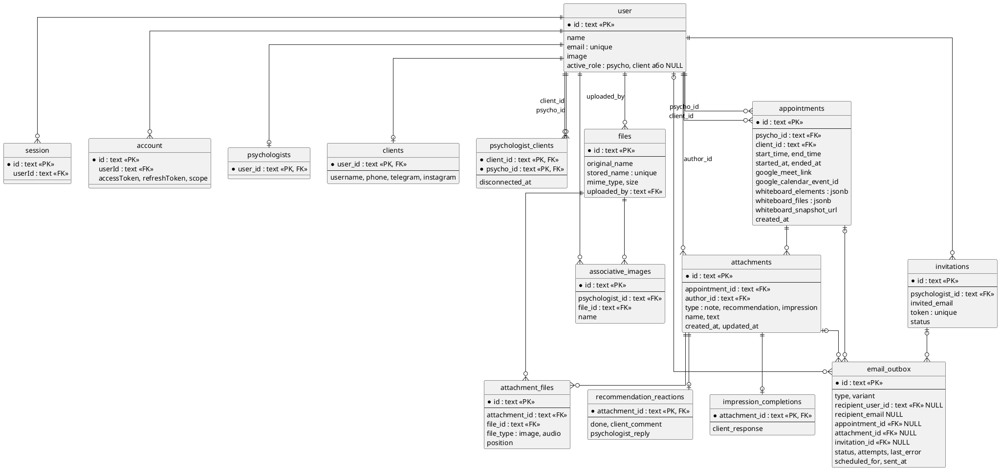

### 3.3.9 Реалізація бази даних: фізична модель

Фізична модель бази даних (додаток П, рисунок 3.21) реалізує логічну модель підрозділу 2.6.6 у PostgreSQL і додає до неї типи атрибутів та обмеження цілісності. Схема містить 17 таблиць: 12 доменних, що відповідають сутностям логічної моделі, і 5 службових. Службові таблиці не передбачалися під час проєктування, бо потреба в них стала очевидною лише під час реалізації. Чотири з них (user, session, account, verification) створює бібліотека Better Auth: логічна модель містить лише сутність «Користувач», а сеанси входу, зовнішні облікові записи та верифікаційні значення є внутрішнім устроєм бібліотеки, який став відомим після її підключення. Міграції проєкту додають до user лише колонку active_role. П’ята таблиця, schema_migrations, потрібна механізму SQL-міграцій, яким створюється схема: вона зберігає перелік застосованих міграцій, щоб жодна з них не виконувалась двічі. Такий механізм є технічним рішенням реалізації, а не частиною предметної області. Первинні ключі доменних таблиць мають тип text зі значенням gen_random_uuid() (розширення pgcrypto), моменти часу – timestamptz, а зовнішні ключі, окрім associative_images.file_id, – ON DELETE CASCADE.

Рисунок 3.21 – Фізична модель бази даних

Обмеження цілісності частково закріплено декларативно: CHECK на значення active_role, type вкладення та file_type, заборона зв’язку користувача із самим собою в psychologist_clients та appointments, а також первинні ключі reactions та completions, що гарантують не більше однієї реакції чи відповіді. Натомість порядок часу сесії (кінець пізніший за початок) і ліміти вкладень перевіряються сервісами. Порівняно з логічною моделлю підрозділу 2.6.6 таблиця email_outbox розширена: колонки recipient_email та invitation_id і дозвіл порожнього recipient_user_id потрібні для листів-запрошень, адресат яких ще не має облікового запису; CHECK email_outbox_recipient_present вимагає наявності хоча б одного адресата. У таблицях нижче «PK» означає первинний ключ, «FK» – зовнішній ключ, а прочерк у стовпці «Обмеження» – що значення може бути порожнім.

Таблиця «user» зберігає облікові записи всіх користувачів системи: ім’я, електронну пошту, зображення профілю та роль, яку користувач обрав останньою. Таблицю створює Better Auth, а проєкт додає до неї колонку active_role зі значенням psycho, client або NULL. Електронна пошта унікальна. Атрибути таблиці наведено в таблиці 3.7.

Таблиця 3.7 – Атрибути таблиці «user»

| Назва поля | Тип даних | Обмеження |
| ----- | ----- | ----- |
| id | TEXT | PK, NOT NULL |
| name | TEXT | NOT NULL |
| email | TEXT | UNIQUE, NOT NULL |
| emailVerified | BOOLEAN | NOT NULL |
| image | TEXT | - |
| createdAt | TIMESTAMPTZ | NOT NULL, DEFAULT CURRENT_TIMESTAMP |
| updatedAt | TIMESTAMPTZ | NOT NULL, DEFAULT CURRENT_TIMESTAMP |
| active_role | TEXT | CHECK (psycho, client) |

Таблиця «session» зберігає сеанси входу користувачів: токен, строк дії, IP-адресу та агент браузера. Сеансами керує бібліотека Better Auth. Зовнішній ключ userId посилається на user.id. Атрибути таблиці наведено в таблиці 3.8.

Таблиця 3.8 – Атрибути таблиці «session»

| Назва поля | Тип даних | Обмеження |
| ----- | ----- | ----- |
| id | TEXT | PK, NOT NULL |
| expiresAt | TIMESTAMPTZ | NOT NULL |
| token | TEXT | UNIQUE, NOT NULL |
| createdAt | TIMESTAMPTZ | NOT NULL, DEFAULT CURRENT_TIMESTAMP |
| updatedAt | TIMESTAMPTZ | NOT NULL |
| ipAddress | TEXT | - |
| userAgent | TEXT | - |
| userId | TEXT | FK, NOT NULL |

Таблиця «account» зв’язує користувача з зовнішнім провайдером входу, у цьому проєкті з Google. Вона зберігає токени доступу й оновлення та строки їх дії, потрібні для виклику Google Calendar API. Зовнішній ключ userId посилається на user.id. Атрибути таблиці наведено в таблиці 3.9.

Таблиця 3.9 – Атрибути таблиці «account»

| Назва поля | Тип даних | Обмеження |
| ----- | ----- | ----- |
| id | TEXT | PK, NOT NULL |
| accountId | TEXT | NOT NULL |
| providerId | TEXT | NOT NULL |
| userId | TEXT | FK, NOT NULL |
| accessToken | TEXT | - |
| refreshToken | TEXT | - |
| idToken | TEXT | - |
| accessTokenExpiresAt | TIMESTAMPTZ | - |
| refreshTokenExpiresAt | TIMESTAMPTZ | - |
| scope | TEXT | - |
| password | TEXT | - |
| createdAt | TIMESTAMPTZ | NOT NULL, DEFAULT CURRENT_TIMESTAMP |
| updatedAt | TIMESTAMPTZ | NOT NULL |

Таблиця «verification» зберігає тимчасові верифікаційні значення зі строком дії. Її створює й використовує лише Better Auth. Атрибути таблиці наведено в таблиці 3.10.

Таблиця 3.10 – Атрибути таблиці «verification»

| Назва поля | Тип даних | Обмеження |
| ----- | ----- | ----- |
| id | TEXT | PK, NOT NULL |
| identifier | TEXT | NOT NULL |
| value | TEXT | NOT NULL |
| expiresAt | TIMESTAMPTZ | NOT NULL |
| createdAt | TIMESTAMPTZ | NOT NULL, DEFAULT CURRENT_TIMESTAMP |
| updatedAt | TIMESTAMPTZ | NOT NULL, DEFAULT CURRENT_TIMESTAMP |

Таблиця «psychologists» містить профілі психологів. Рядок створює тригер user_role_rows під час створення користувача. Первинний ключ user_id одночасно є зовнішнім ключем на user.id. Атрибути таблиці наведено в таблиці 3.11.

Таблиця 3.11 – Атрибути таблиці «psychologists»

| Назва поля | Тип даних | Обмеження |
| ----- | ----- | ----- |
| user_id | TEXT | PK, FK, NOT NULL |

Таблиця «clients» містить профілі клієнтів з необов’язковими контактними даними: логіном, телефоном, обліковими записами Telegram та Instagram. Рядок створює той самий тригер user_role_rows. Первинний ключ user_id одночасно є зовнішнім ключем на user.id. Атрибути таблиці наведено в таблиці 3.12.

Таблиця 3.12 – Атрибути таблиці «clients»

| Назва поля | Тип даних | Обмеження |
| ----- | ----- | ----- |
| user_id | TEXT | PK, FK, NOT NULL |
| username | TEXT | - |
| phone | TEXT | - |
| telegram | TEXT | - |
| instagram | TEXT | - |

Єдина збережена процедура бази даних – тригерна функція ensure_user_role_rows мовою PL/pgSQL. Тригер user_role_rows викликає її після кожної вставки рядка в таблицю user, а функція додає до таблиць psychologists і clients по одному рядку з ідентифікатором нового користувача. Вираз ON CONFLICT DO NOTHING робить повторний виклик безпечним, тому кожен новий користувач одразу має обидва профілі й може обрати будь-яку роль. Та сама міграція створила відсутні профілі для користувачів, які вже існували.

Таблиця «psychologist_clients» реалізує зв’язок «багато до багатьох» між психологами та клієнтами. Колонка disconnected_at зберігає момент розриву зв’язку, тому історія співпраці не втрачається. Обидва ключі посилаються на user.id, а CHECK забороняє зв’язати користувача із самим собою. Атрибути таблиці наведено в таблиці 3.13.

Таблиця 3.13 – Атрибути таблиці «psychologist_clients»

| Назва поля | Тип даних | Обмеження |
| ----- | ----- | ----- |
| client_id | TEXT | PK, FK, NOT NULL |
| psycho_id | TEXT | PK, FK, NOT NULL |
| disconnected_at | TIMESTAMPTZ | - |

Таблиця «appointments» зберігає сесії: учасників, заплановані початок і кінець, фактичні початок і кінець, посилання на Google Meet та ідентифікатор події Google Calendar. Стан дошки (елементи, файли й знімок) також зберігається в цій таблиці. Колонки статусу немає, бо статус обчислюється з часових колонок. Обидва ключі посилаються на user.id, а CHECK забороняє сесію користувача із самим собою. Атрибути таблиці наведено в таблиці 3.14.

Таблиця 3.14 – Атрибути таблиці «appointments»

| Назва поля | Тип даних | Обмеження |
| ----- | ----- | ----- |
| id | TEXT | PK, NOT NULL |
| psycho_id | TEXT | FK, NOT NULL |
| client_id | TEXT | FK, NOT NULL |
| start_time | TIMESTAMPTZ | NOT NULL |
| end_time | TIMESTAMPTZ | NOT NULL |
| started_at | TIMESTAMPTZ | - |
| ended_at | TIMESTAMPTZ | - |
| google_meet_link | TEXT | - |
| google_calendar_event_id | TEXT | - |
| whiteboard_elements | JSONB | - |
| whiteboard_files | JSONB | - |
| whiteboard_snapshot_url | TEXT | - |
| created_at | TIMESTAMPTZ | NOT NULL, DEFAULT now() |

Таблиця «attachments» зберігає вкладення до сесій трьох видів: нотатки, рекомендації та враження. Колонка type визначає вид, а автор вказується в author_id. Зовнішні ключі посилаються на appointments.id та user.id. Атрибути таблиці наведено в таблиці 3.15.

Таблиця 3.15 – Атрибути таблиці «attachments»

| Назва поля | Тип даних | Обмеження |
| ----- | ----- | ----- |
| id | TEXT | PK, NOT NULL |
| appointment_id | TEXT | FK, NOT NULL |
| author_id | TEXT | FK, NOT NULL |
| type | TEXT | NOT NULL, CHECK (note, impression, recommendation) |
| name | TEXT | NOT NULL |
| text | TEXT | - |
| created_at | TIMESTAMPTZ | NOT NULL, DEFAULT now() |
| updated_at | TIMESTAMPTZ | NOT NULL, DEFAULT now() |

Таблиця «files» зберігає метадані завантажених файлів: початкову й збережену назви, тип MIME та розмір. Самі файли лежать на диску в каталозі uploads. Збережена назва унікальна, а зовнішній ключ uploaded_by посилається на user.id. Атрибути таблиці наведено в таблиці 3.16.

Таблиця 3.16 – Атрибути таблиці «files»

| Назва поля | Тип даних | Обмеження |
| ----- | ----- | ----- |
| id | TEXT | PK, NOT NULL |
| original_name | TEXT | NOT NULL |
| stored_name | TEXT | UNIQUE, NOT NULL |
| mime_type | TEXT | NOT NULL |
| size | BIGINT | NOT NULL |
| uploaded_by | TEXT | FK, NOT NULL |
| created_at | TIMESTAMPTZ | NOT NULL, DEFAULT now() |

Таблиця «attachment_files» зв’язує вкладення з файлами. Вона зберігає вид файлу (зображення чи аудіо) та його порядковий номер у вкладенні. Зовнішні ключі посилаються на attachments.id та files.id. Атрибути таблиці наведено в таблиці 3.17.

Таблиця 3.17 – Атрибути таблиці «attachment_files»

| Назва поля | Тип даних | Обмеження |
| ----- | ----- | ----- |
| id | TEXT | PK, NOT NULL |
| attachment_id | TEXT | FK, NOT NULL |
| file_id | TEXT | FK, NOT NULL |
| file_type | TEXT | NOT NULL, CHECK (image, audio) |
| position | INTEGER | NOT NULL, DEFAULT 0 |
| created_at | TIMESTAMPTZ | NOT NULL, DEFAULT now() |

Таблиця «recommendation_reactions» зберігає реакцію клієнта на рекомендацію: позначку виконання, коментар клієнта та відповідь психолога. Первинний ключ attachment_id гарантує не більше однієї реакції на рекомендацію. Атрибути таблиці наведено в таблиці 3.18.

Таблиця 3.18 – Атрибути таблиці «recommendation_reactions»

| Назва поля | Тип даних | Обмеження |
| ----- | ----- | ----- |
| attachment_id | TEXT | PK, FK, NOT NULL |
| done | BOOLEAN | NOT NULL, DEFAULT false |
| client_comment | TEXT | - |
| psychologist_reply | TEXT | - |
| updated_at | TIMESTAMPTZ | NOT NULL, DEFAULT now() |

Таблиця «impression_completions» зберігає відповідь клієнта на враження психолога. Первинний ключ attachment_id гарантує не більше однієї відповіді на враження. Атрибути таблиці наведено в таблиці 3.19.

Таблиця 3.19 – Атрибути таблиці «impression_completions»

| Назва поля | Тип даних | Обмеження |
| ----- | ----- | ----- |
| attachment_id | TEXT | PK, FK, NOT NULL |
| client_response | TEXT | NOT NULL |
| created_at | TIMESTAMPTZ | NOT NULL, DEFAULT now() |

Таблиця «invitations» зберігає запрошення клієнтів: адресу запрошеного, унікальний токен для посилання та статус запрошення. Зовнішній ключ psychologist_id посилається на user.id. Колонку expires_at видалено однією з міграцій. Атрибути таблиці наведено в таблиці 3.20.

Таблиця 3.20 – Атрибути таблиці «invitations»

| Назва поля | Тип даних | Обмеження |
| ----- | ----- | ----- |
| id | TEXT | PK, NOT NULL |
| psychologist_id | TEXT | FK, NOT NULL |
| invited_email | TEXT | NOT NULL |
| token | TEXT | UNIQUE, NOT NULL, DEFAULT gen_random_uuid() |
| status | TEXT | NOT NULL, DEFAULT 'pending' |
| created_at | TIMESTAMPTZ | NOT NULL, DEFAULT now() |

Таблиця «associative_images» містить бібліотеку асоціативних зображень психолога: назву та посилання на файл. Зовнішній ключ psychologist_id має ON DELETE CASCADE, а зовнішній ключ file_id на files.id каскаду не має. Атрибути таблиці наведено в таблиці 3.21.

Таблиця 3.21 – Атрибути таблиці «associative_images»

| Назва поля | Тип даних | Обмеження |
| ----- | ----- | ----- |
| id | TEXT | PK, NOT NULL |
| psychologist_id | TEXT | FK, NOT NULL |
| name | TEXT | NOT NULL |
| file_id | TEXT | FK, NOT NULL |
| created_at | TIMESTAMPTZ | NOT NULL, DEFAULT now() |
| updated_at | TIMESTAMPTZ | NOT NULL, DEFAULT now() |

Таблиця «email_outbox» є чергою вихідних листів: тип і варіант листа, адресат, пов’язана сесія, вкладення чи запрошення, статус, кількість спроб, остання помилка та час надсилання. Унікальний індекс email_outbox_dedup запобігає дублюванню листів, а частковий індекс за (status, scheduled_for) для статусу pending прискорює вибірку листів до надсилання. Атрибути таблиці наведено в таблиці 3.22.

Таблиця 3.22 – Атрибути таблиці «email_outbox»

| Назва поля | Тип даних | Обмеження |
| ----- | ----- | ----- |
| id | TEXT | PK, NOT NULL |
| type | TEXT | NOT NULL |
| variant | TEXT | - |
| recipient_user_id | TEXT | FK |
| recipient_email | TEXT | - |
| appointment_id | TEXT | FK |
| attachment_id | TEXT | FK |
| invitation_id | TEXT | FK |
| status | TEXT | NOT NULL, DEFAULT 'pending' |
| attempts | INTEGER | NOT NULL, DEFAULT 0 |
| last_error | TEXT | - |
| scheduled_for | TIMESTAMPTZ | NOT NULL, DEFAULT now() |
| created_at | TIMESTAMPTZ | NOT NULL, DEFAULT now() |
| sent_at | TIMESTAMPTZ | - |

Остання таблиця «schema_migrations» є службовою. Вона зберігає назви застосованих SQL-міграцій і час їх застосування, тому міграції не виконуються повторно. Атрибути таблиці наведено в таблиці 3.23.

Таблиця 3.23 – Атрибути таблиці «schema_migrations»

| Назва поля | Тип даних | Обмеження |
| ----- | ----- | ----- |
| name | VARCHAR(255) | PK, NOT NULL |
| applied_at | TIMESTAMPTZ | DEFAULT CURRENT_TIMESTAMP |
