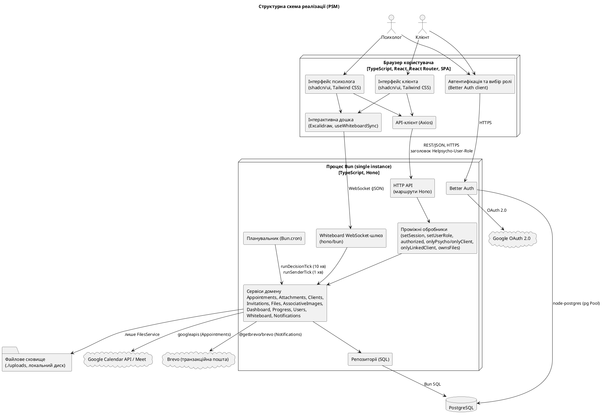
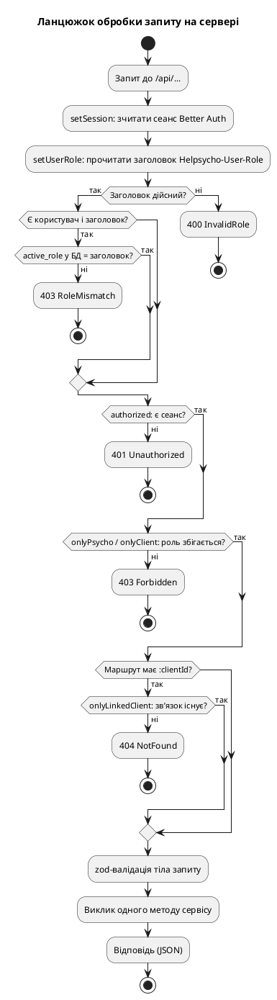
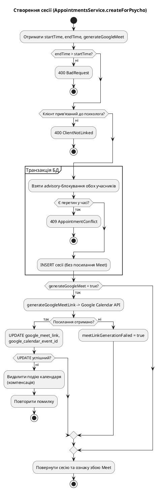
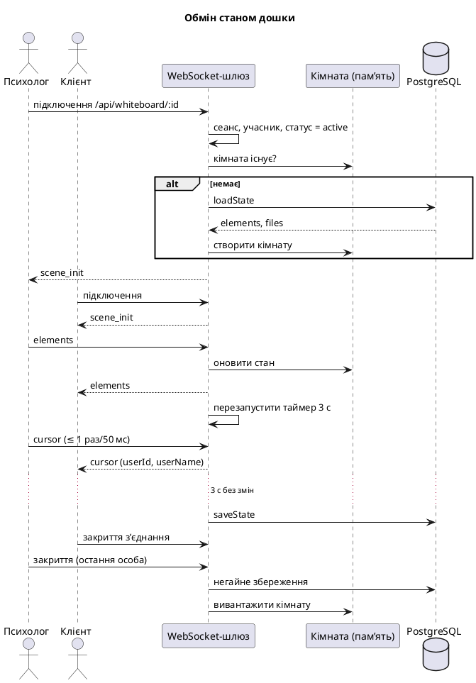
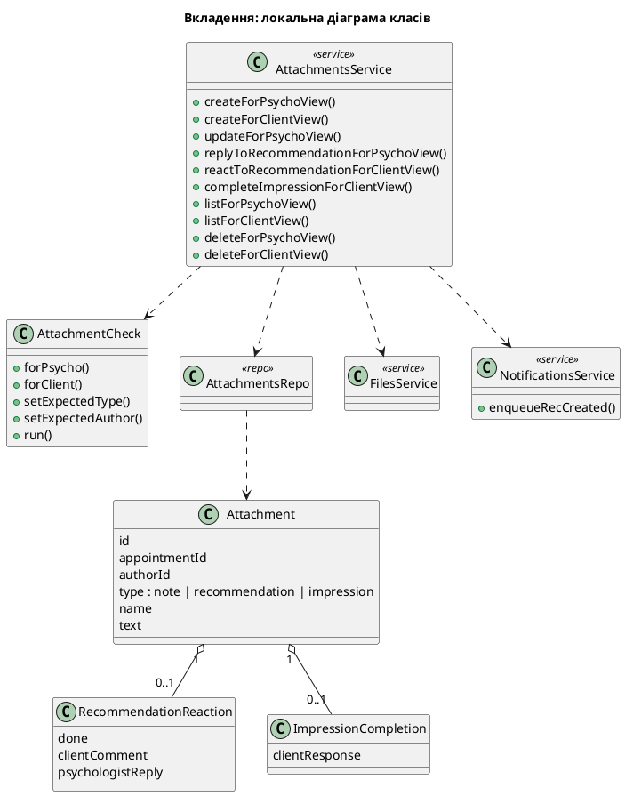
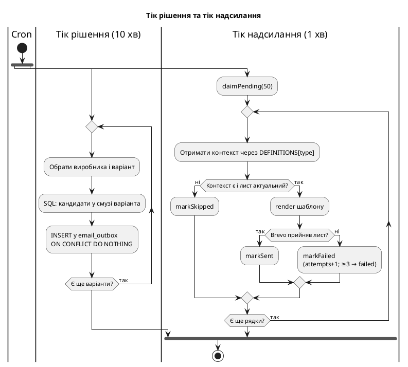
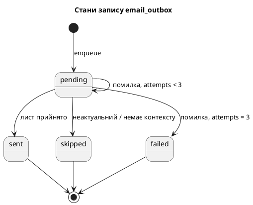
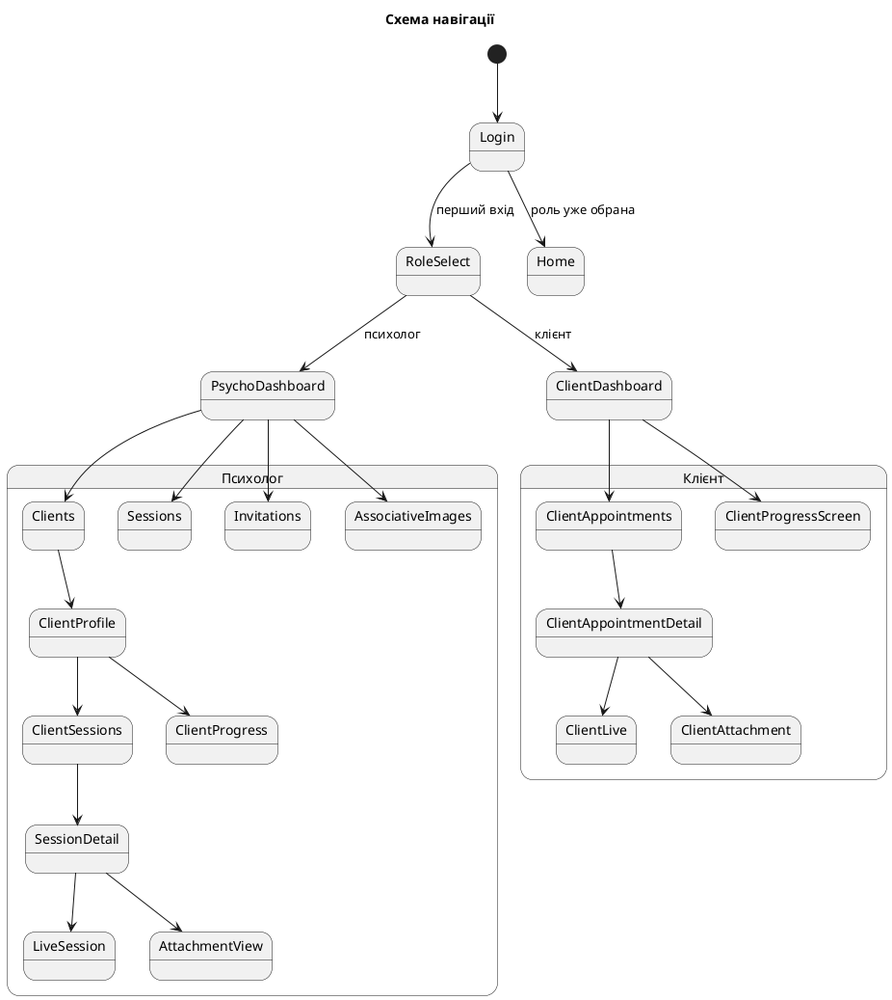

# Розділ 3 — версія 1

## Службова примітка (не входить до тексту роботи)

Цикл 1. Аналіз прогалин у третьому розділі, яким він є в paper.md.

Знайдені прогалини:

1. Відсутній підрозділ 3.3 «Розробка компонентів ПЗ» — головна вимога методички (п. 1.5): реалізація кожного пакета з розділу 2 на блок-схемах, діаграмах діяльності та класів.
2. Відсутня фізична модель БД як підрозділ розділу (є лише чернетка в docs/sections).
3. Відсутня загальна діаграма класів (обов'язковий завершальний підрозділ 3.3).
4. Підрозділи інтерфейсу й тестування мають номери-заглушки «3.xxx», «3.x.xxх».
5. Заголовок розділу містить слово «ОНЛАЙН» замість «ВІДДАЛЕНОЇ».
6. Відсутні висновки до розділу.
7. У тексті 3.1 порожні посилання на джерела («\[\]»).
8. Немає висновку про готовність ПЗ до впровадження та зв'язку тестування з вимогами (таблиця за зразком додатка Б методички).
9. Діаграми розділу 3 у тексті не подані у вигляді вихідного коду (PlantUML).

Рішення:

- Структура: 3.1 мова й середовище; 3.2 структурна схема; 3.3 розробка компонентів (3.3.1–3.3.9); 3.4 інтерфейс користувача; 3.5 тестування; висновки.
- Підрозділи 3.3.2–3.3.5 відповідають пакетам 2.6.1–2.6.4 та вимогам 2.5; 3.3.1 охоплює наскрізну інфраструктуру (маршрутизація, автентифікація, ролі).
- Діаграми подано у PlantUML у цьому ж файлі.
- Тексти 3.1, 3.2, інтерфейсу і тестування взято з paper.md та docs/sections і впорядковано за новою нумерацією.

---

# РОЗДІЛ 3 РОЗРОБКА ТА ТЕСТУВАННЯ СЕРВІСУ ПІДТРИМКИ ВІДДАЛЕНОЇ РОБОТИ ПСИХОЛОГА

## 3.1 Вибір мови та середовища програмування для реалізації сервісу підтримки віддаленої роботи психолога

Мовою програмування для обох частин системи обрано TypeScript [ДЖ-TS]. TypeScript – це мова зі статичною типізацією, яка компілюється у JavaScript. Статична типізація дозволяє виявляти значну частину помилок на етапі розробки, а використання однієї мови для клієнтської та серверної частин зменшує перемикання контексту.

Середовищем виконання серверного коду обрано Bun [ДЖ-Bun]. Bun містить вбудовані менеджер пакетів, виконавець тестів, клієнт для PostgreSQL, планувальник завдань за розкладом (Bun.cron) та підтримку WebSocket-зʼєднань. Усі тести серверної частини виконуються вбудованим виконавцем тестів Bun.

Для побудови серверного REST API використано вебфреймворк Hono [ДЖ-Hono]. Він надає маршрутизацію, проміжні обробники (middleware) та нативну підтримку Bun WebSocket.

Для зберігання даних обрано PostgreSQL [ДЖ-PG]. Вона забезпечує транзакційність, а тип JSONB дозволяє зберігати стан інтерактивної дошки поруч із реляційними даними.

ORM-бібліотек не використано. Усі запити – параметризовані SQL-запити через вбудований PostgreSQL-клієнт Bun (шаблонні літерали), що захищає від SQL-інʼєкцій і дає повний контроль над запитами. Схема змінюється SQL-міграціями, які зберігаються в репозиторії.

Клієнтська частина побудована на бібліотеці React [ДЖ-React] та фреймворку React Router [ДЖ-RR] у режимі односторінкового застосунку. Інтерфейс реалізовано з бібліотекою компонентів shadcn/ui [ДЖ-shadcn] та Tailwind CSS [ДЖ-Tailwind].

Для автентифікації використано Better Auth [ДЖ-BA] з OAuth 2.0 від Google [ДЖ-OAuth]. Система не зберігає паролів, а Google гарантує валідність адрес електронної пошти й наявність облікового запису для створення Google Meet.

Взаємодію в реальному часі реалізовано на протоколі WebSocket [ДЖ-WS], а дошку – на бібліотеці Excalidraw [ДЖ-Excalidraw]. Інтеграцію з календарем виконано через Google Calendar API [ДЖ-GCal] (бібліотека googleapis), а листи надсилаються сервісом Brevo [ДЖ-Brevo].

Клієнт HTTP на фронтенді – Axios. Тестування клієнтської частини виконується фреймворком Vitest. Середовище розробки – редактор Zed [ДЖ-Zed].

## 3.2 Структурна схема реалізації сервісу підтримки віддаленої роботи психолога

Структурну схему реалізації наведено на рисунку 3.1 і в додатку Н. Вона є платформозалежною моделлю (PSM) і деталізує уточнену діаграму компонентів розділу 2 (додаток Г): склад сервісів і напрямки звернень збережено, а для кожного вузла вказано середовище виконання, протоколи та драйвери.



Рисунок 3.1 – Структурна схема реалізації сервісу підтримки віддаленої роботи психолога

Клієнтську частину розгорнуто у вузлі «Браузер користувача». Вона містить компонент автентифікації та вибору ролі, два рольові інтерфейси, інтерактивну дошку та спільний API-клієнт (Axios), через який проходять усі REST-запити. Актор «Психолог» працює з інтерфейсом психолога, актор «Клієнт» – з інтерфейсом клієнта; обидва користуються спільною дошкою.

Серверну частину розгорнуто в одному процесі Bun, який поєднує HTTP API, WebSocket-шлюз дошки та внутрішньопроцесний планувальник. Усі запити проходять ланцюжок проміжних обробників (див. 3.3.1), після чого викликають рівно один метод доменного сервісу. Сервіси працюють з даними через шар репозиторіїв, який виконує параметризований SQL через Bun SQL. Окремо до тієї ж бази підключається Better Auth через драйвер node-postgres, бо він не підтримує вбудований клієнт Bun. Файли зберігаються на локальному диску, і лише FilesService звертається до цього сховища.

Із зовнішніх систем використано три канали: Google OAuth 2.0 (вхід), Google Calendar API (події з Meet), Brevo (листи). Стереотип «single instance» означає, що систему розгортають в одному екземплярі: планувальник і файлове сховище не поділяються між репліками, тому декілька копій процесу призвели б до дублювання листів і неузгодженості файлів. Дошка також зберігає кімнати в памʼяті процесу, тому це обмеження стосується і її. Для передбачуваного навантаження такого розгортання достатньо.

## 3.3 Розробка компонентів сервісу підтримки віддаленої роботи психолога

Підрозділи 3.3.2–3.3.5 реалізують пакети, детально спроєктовані в підрозділах 2.6.1–2.6.4. Підрозділ 3.3.1 описує наскрізну інфраструктуру сервера, підрозділи 3.3.6–3.3.9 – допоміжні модулі, базу даних і загальну структуру коду. Код організовано за предметними модулями: кожен модуль у каталозі features містить маршрути, сервіс і репозиторій, які експортуються як заморожені константні обʼєкти (наприклад, AppointmentsService, AppointmentsRepo).

### 3.3.1 Реалізація серверного застосунку: маршрутизація, автентифікація та розмежування доступу

Маршрути розподілено за ролями: шлях /api/clients/:clientId/... обслуговує психолога, /api/client/... – клієнта, /api/psycho/... – психолога без вказання клієнта. Кожен маршрут виконує чітко визначену послідовність дій: перевірку вхідних даних схемою zod, проходження проміжних обробників, один виклик методу сервісу, формування HTTP-відповіді. Бізнес-перевірки, транзакції та звернення до зовнішніх сервісів виконують сервіси, а SQL – репозиторії. Сервіси створюють помилки-нащадки AppError з кодом, за яким клієнт розрізняє ситуацію; єдиний обробник onError перетворює їх на JSON-відповідь зі статусом.

Ланцюжок обробки запиту показано на рисунку 3.2. Спочатку setSession зчитує сеанс Better Auth за cookie. Потім setUserRole читає заголовок Helpsycho-User-Role (psycho або client) і порівнює його з полем active_role користувача в базі; за розбіжності повертається 403 з кодом RoleMismatch. Далі guard authorized відхиляє запити без сеансу (401), а onlyPsychoRequest і onlyClientRequest – запити з невідповідною роллю (403). Для маршрутів з параметром :clientId onlyLinkedClient перевіряє звʼязок психолога з клієнтом і повертає 404, щоб не розкривати існування чужих даних. Обробник ownsFiles перевіряє, що всі ідентифікатори файлів у тілі запиту завантажив той самий користувач.



Рисунок 3.2 – Діаграма діяльності обробки запиту на сервері

Автентифікацію виконує Better Auth із провайдером Google. Для психолога запитується додатковий дозвіл calendar.events з режимом offline, щоб сервер міг створювати події календаря. Токени зберігаються в таблиці account. Після створення облікового запису тригер бази даних створює рядки профілів психолога і клієнта, а роль користувач обирає на окремому екрані; вибір записується в active_role.

### 3.3.2 Реалізація планування сесій та інтеграції з Google Meet

Сервіс AppointmentsService реалізує життєвий цикл сесії: створення, редагування, видалення, початок і завершення. Алгоритм створення сесії наведено на рисунку 3.3. Спочатку перевіряється, що час завершення пізніший за час початку і що клієнт привʼязаний до психолога. Далі в транзакції отримуються консультативні блокування pg_advisory_xact_lock для обох учасників (у впорядкованому вигляді, щоб уникнути взаємного блокування), перевіряється відсутність перетину з іншими сесіями будь-кого з двох учасників і вставляється рядок сесії. Лише після завершення транзакції, якщо психолог обрав генерацію Google Meet, сервіс викликає Google Calendar API. Збій цього виклику не скасовує сесію: відповідь містить ознаку meetLinkGenerationFailed. Це реалізує нефункціональну вимогу доступності (створення сесії не залежить від зовнішніх сервісів).



Рисунок 3.3 – Діаграма діяльності створення сесії

Редагування дозволено лише для майбутніх сесій. Якщо психолог просить перенести подію в календарі, сервіс оновлює подію в Google Calendar до запису в базу; коли оновлення календаря не вдалося, зміну скасовано з помилкою 502 MeetRescheduleFailed, щоб база і календар не розходилися. Якщо запис у базу після зміни календаря не вдався, сервіс повертає подію до старого часу або видаляє створену подію. Видалення сесії також видаляє подію календаря, але збій цього виклику лише повертається як прапорець meetDeleteFailed.

Статус сесії не зберігається, а обчислюється SQL-виразом CASE із полів started_at, ended_at, start_time та end_time: «минула» (past) – є обидві фактичні позначки; «активна» (active) – лише started_at; «майбутня» (upcoming) – поточний час раніше початку; «потребує уваги» (warning) – час початку минув, але не пізніше завершення; «пропущена» (missed) – інакше. Початок сесії виконується в транзакції під тими ж блокуваннями, що гарантує, що в психолога одночасно є не більше однієї активної сесії. Завершення виконується лише психологом, зберігає PNG-знімок дошки й очищує збережений стан дошки.

### 3.3.3 Реалізація інтерактивної дошки та обміну даними в реальному часі

Дошка реалізована WebSocket-шлюзом за адресою /api/whiteboard/:appointmentId (модуль whiteboard). Під час встановлення зʼєднання шлюз перевіряє сеанс, належність користувача до сесії та статус «активна»; у разі невдачі зʼєднання закривається з кодом 1008. Для кожної сесії сервер тримає в памʼяті кімнату, що містить множину зʼєднань і поточний стан сцени (елементи й файли). Перший учасник завантажує стан із колонок whiteboard_elements та whiteboard_files, наступні отримують його з памʼяті; кожен новий учасник отримує повідомлення scene_init.

Протокол складається з трьох типів вхідних повідомлень: elements (повний масив елементів), files (нові вбудовані зображення) та cursor (координати вказівника). Сервер змінює стан у памʼяті, ретранслює повідомлення іншим учасникам і для elements та files відкладено зберігає стан у базу: таймер у 3 секунди скидається при кожній зміні, тож запис виконується після паузи. Курсори не зберігаються. Коли з кімнати виходить останній учасник, відкладений запис виконується негайно, а кімната вивантажується з памʼяті. Сесія залишається активною, поки психолог її не завершить, тому учасник може підключитися знову і отримати збережений стан.

На клієнті хук useWhiteboardSync зʼєднує Excalidraw із WebSocket. Позиція курсору надсилається не частіше ніж раз на 50 мс. Щоб уникнути нескінченного циклу ретрансляції, клієнт порівнює сигнатуру елементів з останнім віддаленим оновленням і не повертає їх назад; порожні масиви елементів ігноруються, бо вони є артефактами ініціалізації й стерли б стан на сервері.



Рисунок 3.4 – Діаграма послідовності обміну станом інтерактивної дошки

### 3.3.4 Реалізація керування вкладеннями

Нотатки, рекомендації та враження реалізує один AttachmentsService, бо вони мають спільну структуру: назва, текст, автор, привʼязка до сесії та впорядковані файли. Тип вкладення визначає лише права і додаткові дані. Нотатку й рекомендацію створює психолог, враження – клієнт, причому лише для активної або завершеної сесії. Кількість вкладень обмежено константами: 15 нотаток, 10 рекомендацій, 10 вражень на сесію; перевірку виконано в транзакції створення, тож гонки не обходять ліміт.

Створення виконується в одній транзакції: перевірка ліміту, вставлення вкладення, привʼязка файлів (з типом image чи audio та позицією), а для рекомендації – постановка листа rec_created в чергу email_outbox. Тому лист не втрачається, якщо транзакцію скасовано, і не надсилається для скасованих записів.

Реакції реалізовано окремими таблицями. Клієнт може позначити рекомендацію виконаною (done) та один раз залишити коментар; психолог може один раз відповісти. Для врахувань клієнт один раз надсилає відповідь (impression_completions). Для перевірок прав використано будівельник AttachmentCheck: він послідовно перевіряє приналежність сесії користувачу, очікуваний тип вкладення й автора та повертає вкладення разом з реакцією. Вкладення з реакцією видаляти не можна.



Рисунок 3.5 – Локальна діаграма класів модуля вкладень

### 3.3.5 Реалізація роботи з файлами та бібліотекою асоціативних зображень

FilesService приймає завантаження файла до 25 МБ. Тип файла визначається за «магічними» байтами (JPEG, PNG, GIF, WebP, WebM, MP4/M4A, OGG, MP3), а MIME-тип і розширення, надіслані клієнтом, ігноруються. Файл зберігається під випадковим іменем UUID у каталозі uploads, а метадані записуються в таблицю files. Віддача файлів доступна лише користувачам, які мають право на файл. Коли вкладення видаляється, його файли, на які більше ніхто не посилається, видаляються з диска (cleanupOrphans).

Бібліотека асоціативних зображень належить психологу і дозволяє завантажувати, перейменовувати, шукати та видаляти зображення. Під час сесії психолог вставляє зображення з бібліотеки на дошку; клієнт бачить його через стан дошки. Файл, на який посилається асоціативне зображення, неможливо видалити, доки існує саме зображення.

### 3.3.6 Реалізація нагадувань та черги поштових сповіщень

Пакет реалізує шаблон «транзакційна скринька вихідних» (transactional outbox). Листи не надсилаються безпосередньо в місці виникнення події: спочатку в таблицю email_outbox записується рядок зі станом pending, а потім окремий процес його надсилає. Є два типи джерел: події (rec_created під час створення рекомендації, invitation_created під час створення запрошення), що ставляться в чергу в тій самій транзакції, та планові нагадування, які породжує cron.

Bun.cron запускає два завдання. Тік рішення виконується кожні 10 хвилин: для session_reminder (варіанти 24h та 1h до початку) і rec_reminder (2d та 1d) кожен виробник виконує SQL-запит кандидатів у «смузі» свого варіанта, щоб сесія, створена за менш ніж добу до початку, не отримала також ширше нагадування, і додає рядки до черги. Унікальний індекс за виразом та INSERT ... ON CONFLICT DO NOTHING роблять повторні тіки безпечними. Тік надсилання виконується щохвилини: бере до 50 рядків pending, для кожного через реєстр DEFINITIONS отримує свіжий контекст, перевіряє актуальність (сесія вже почалася або видалена, запрошення більше не очікує) і лише тоді відображає шаблон та передає лист Brevo. Успіх позначає sent, неактуальний лист – skipped, помилка збільшує лічильник спроб і після трьох спроб переводить рядок у failed. Додавання нового типу листа вимагає лише нового запису в DEFINITIONS.



Рисунок 3.6 – Діаграма діяльності планувальника сповіщень



Рисунок 3.7 – Діаграма станів запису черги листів

### 3.3.7 Реалізація дашбордів та відстеження прогресу клієнта

Модулі dashboard і progress лише обчислюють подання з наявних даних. DashboardService збирає дані паралельно (Promise.all): для психолога – кількість клієнтів, кількість майбутніх і минулих сесій, активну сесію, п'ять найближчих сесій і п'ять останніх клієнтів; для клієнта – список психологів, активну та найближчу сесію, очікувані рекомендації та лічильники за статусом. Статуси «потребує уваги» та «пропущена» зводяться до «майбутні» та «минулі». ProgressService повертає для пари клієнт–психолог завершені сесії, до кожної з яких додано враження та рекомендації з реакціями.

### 3.3.8 Реалізація бази даних: фізична модель

Фізична модель бази даних (додаток П) реалізує логічну модель підрозділу 2.6.6 у PostgreSQL. Схема створюється послідовністю SQL-міграцій, перелік застосованих міграцій зберігається в таблиці schema_migrations. Первинні ключі мають тип text зі значенням gen_random_uuid(), усі моменти часу – timestamptz, зовнішні ключі переважно мають ON DELETE CASCADE.

```plantuml
@startuml
hide circle
skinparam linetype ortho
entity "user" {
  *id : text <<PK>>
  --
  name, email (unique)
  active_role : psycho | client | NULL
}
entity "session" { *id : text; userId : text <<FK>> }
entity "account" { *id : text; userId : text <<FK>>; токени Google }
entity psychologists { *user_id : text <<PK,FK>> }
entity clients {
  *user_id : text <<PK,FK>>
  phone, telegram, instagram
}
entity psychologist_clients {
  *client_id <<PK,FK>>
  *psycho_id <<PK,FK>>
  disconnected_at
}
entity appointments {
  *id : text <<PK>>
  psycho_id <<FK>>
  client_id <<FK>>
  start_time, end_time
  started_at, ended_at
  google_meet_link
  google_calendar_event_id
  whiteboard_elements : jsonb
  whiteboard_files : jsonb
  whiteboard_snapshot_url
}
entity attachments {
  *id : text <<PK>>
  appointment_id <<FK>>
  author_id <<FK>>
  type : note | recommendation | impression
  name, text
}
entity files { *id : text; stored_name (unique); mime_type; size; uploaded_by <<FK>> }
entity attachment_files { attachment_id <<FK>>; file_id <<FK>>; file_type; position }
entity recommendation_reactions { *attachment_id <<PK,FK>>; done; client_comment; psychologist_reply }
entity impression_completions { *attachment_id <<PK,FK>>; client_response }
entity invitations { *id; psychologist_id <<FK>>; email; token (unique); status }
entity associative_images { *id; psychologist_id <<FK>>; name; file_id <<FK>> }
entity email_outbox {
  *id; type; variant
  recipient_user_id <<FK>> NULL
  recipient_email NULL
  appointment_id, attachment_id, invitation_id <<FK>> NULL
  status; attempts; last_error
  scheduled_for; sent_at
}
"user" ||--o| psychologists
"user" ||--o| clients
"user" ||--o{ session
"user" ||--o{ account
psychologists }o--o{ clients
psychologist_clients }o--|| "user"
appointments }o--|| "user"
attachments }o--|| appointments
attachments ||--o{ attachment_files
files ||--o{ attachment_files
attachments ||--o| recommendation_reactions
attachments ||--o| impression_completions
invitations }o--|| "user"
associative_images }o--|| files
email_outbox }o--o| appointments
email_outbox }o--o| attachments
email_outbox }o--o| invitations
@enduml
```

Рисунок 3.8 – Фізична модель бази даних

Опис таблиць: user, session, account та verification створює Better Auth, проєкт додає лише колонку active_role. Таблиці psychologists і clients мають первинний ключ user_id; тригер створює обидва профілі при створенні користувача. Таблиця psychologist_clients реалізує зв'язок «багато до багатьох» з колонкою disconnected_at (історія звʼязку). Таблиця appointments не має колонки статусу; стан дошки зберігається в jsonb. Для обох таблиць psychologist_clients та appointments обмеженням CHECK заборонено звʼязок користувача із самим собою. Таблиця attachments має CHECK на тип і складений індекс (appointment_id, type). Таблиці recommendation_reactions та impression_completions гарантують не більше однієї реакції. Таблиця files містить лише метадані, а attachment_files зберігає вид файла й позицію. Таблиця invitations містить унікальний токен і статус. Таблиця associative_images посилається на files без каскаду. Таблиця email_outbox містить унікальний індекс за виразами (тип, сесія, вкладення, запрошення, отримувач, варіант з COALESCE) і частковий індекс (status, scheduled_for) WHERE status = 'pending'.

### 3.3.9 Загальна діаграма класів програмного продукту

Код серверної частини не використовує класи: модулі є замороженими константними обʼєктами. У діаграмі їх зображено як класи зі стереотипами «routes», «service» і «repo», а моделі даних – як класи даних. Така відповідність дозволяє застосувати діаграму класів до функціонального коду.

```plantuml
@startuml
title Загальна діаграма класів (серверна частина)
skinparam classAttributeIconSize 0
package "Проміжні обробники" {
  class AuthMiddlewares <<middleware>> {
    setSession()
    setUserRole()
    authorized()
    onlyPsychoRequest()
    onlyClientRequest()
    onlyLinkedClient()
    ownsFiles()
  }
}
package "Сервіси" {
  class AppointmentsService <<service>>
  class AttachmentsService <<service>>
  class ClientsService <<service>>
  class InvitationsService <<service>>
  class FilesService <<service>>
  class AssociativeImagesService <<service>>
  class DashboardService <<service>>
  class ProgressService <<service>>
  class UsersService <<service>>
  class WhiteboardService <<service>>
  class NotificationsService <<service>>
}
package "Репозиторії" {
  class AppointmentsRepo <<repo>>
  class AttachmentsRepo <<repo>>
  class ClientsRepo <<repo>>
  class InvitationsRepo <<repo>>
  class FilesRepo <<repo>>
  class AssociativeImagesRepo <<repo>>
  class DashboardRepo <<repo>>
  class ProgressRepo <<repo>>
  class UsersRepo <<repo>>
  class WhiteboardRepo <<repo>>
  class NotificationsRepo <<repo>>
}
package "Зовнішні інтеграції" {
  class GoogleMeet <<util>> {
    generateGoogleMeetLink()
    rescheduleGoogleCalendarEvent()
    deleteGoogleCalendarEvent()
  }
  class EmailService <<adapter>> { send() }
  class WhiteboardGateway <<websocket>>
}
class AppError
class NotFoundError
class BadRequestError
class ConflictError
class ForbiddenError
class BadGatewayError
AppError <|-- NotFoundError
AppError <|-- BadRequestError
AppError <|-- ConflictError
AppError <|-- ForbiddenError
AppError <|-- BadGatewayError

AppointmentsService ..> AppointmentsRepo
AppointmentsService ..> ClientsRepo
AppointmentsService ..> GoogleMeet
AppointmentsService ..> WhiteboardService
AttachmentsService ..> AttachmentsRepo
AttachmentsService ..> AppointmentsService
AttachmentsService ..> FilesService
AttachmentsService ..> NotificationsService
ClientsService ..> ClientsRepo
InvitationsService ..> InvitationsRepo
InvitationsService ..> ClientsService
InvitationsService ..> NotificationsService
FilesService ..> FilesRepo
AssociativeImagesService ..> AssociativeImagesRepo
DashboardService ..> DashboardRepo
ProgressService ..> ProgressRepo
UsersService ..> UsersRepo
WhiteboardService ..> WhiteboardRepo
NotificationsService ..> NotificationsRepo
NotificationsService ..> EmailService
WhiteboardGateway ..> WhiteboardService
WhiteboardGateway ..> AppointmentsService
AuthMiddlewares ..> UsersRepo
AuthMiddlewares ..> ClientsRepo
AuthMiddlewares ..> FilesRepo
@enduml
```

Рисунок 3.9 – Загальна діаграма класів серверної частини

Шарова структура дотримується правила: маршрути викликають сервіси, сервіси – репозиторії та інші сервіси, репозиторії лише виконують SQL. Єдиним винятком є проміжні обробники, які для швидких перевірок звертаються до репозиторіїв напряму.

## 3.4 Реалізація інтерфейсу користувача сервісу підтримки віддаленої роботи психолога

Інтерфейс розмежовано за роллю на дві групи екранів, які мають спільну навігаційну оболонку з бічною панеллю та однакову візуальну мову карток, таблиць, модальних вікон і форм. Маршрути визначено у файлі routes.ts: екрани психолога розташовано під /psycho, екрани клієнта – під /client і /me. Схему переходів наведено на рисунку 3.10.



Рисунок 3.10 – Схема навігації односторінкового застосунку

Інтерфейс психолога. Дашборд показує панель активної сесії з кнопкою переходу, три лічильники (клієнти, майбутні, минулі сесії), найближчі сесії та останніх клієнтів. Список сесій – таблиця з сортуванням, кольоровим позначенням статусу, кількістю нотаток, рекомендацій і вражень та кнопкою «Запланувати сесію». Екран живої сесії містить інтерактивну дошку, лічильник часу, кнопки приєднання до відеодзвінка та завершення (із підтвердженням), а також висувну панель нотаток, рекомендацій і зображень. Після завершення сесії без наступної запланованої психологу пропонується призначити її. Нотатки, рекомендації та враження створюються через одну спільну форму.

Інтерфейс клієнта. Дашборд клієнта показує список психологів, найближчу та активну сесії та блок очікуваних рекомендацій, які можна одразу позначити виконаними чи прокоментувати. Екран прогресу – горизонтальна стрічка сесій, де розгортання точки показує повʼязані рекомендації та враження; якщо психологів декілька, над стрічкою розташовано перемикач.

*(Скриншоти екранів – рисунки 3.11–3.16 – надає автор.)*

## 3.5 Тестування сервісу підтримки віддаленої роботи психолога

Застосовано три види тестування: інтеграційне серверної частини (основне), компонентне тестування клієнтської частини та ручне функціональне тестування інтерфейсу. Інтеграційні тести викликають реальні маршрути Hono і проходять повний ланцюжок: проміжні обробники, сервіси, репозиторії та реальну базу PostgreSQL. Тести виконує вбудований виконавець Bun послідовно на окремій базі: перед запуском застосовуються міграції, перед кожним тестом таблиці очищуються. База й внутрішні сервіси не імітуються.

Таблиця 3.1 – Результати інтеграційного тестування серверної частини

| Домен | К-ть тестів | Перевірка доступу | Результат |
| ----- | ----- | ----- | ----- |
| Сесії (планування, статуси) | 94 | так | пройдено |
| Вкладення (нотатки, рекомендації, враження) | 128 | так | пройдено |
| Керування клієнтами | 39 | так | пройдено |
| Запрошення (з повторним залученням) | 39 | так | пройдено |
| Асоціативні зображення | 23 | так | пройдено |
| Дашборди психолога і клієнта | 26 | так | пройдено |
| Файли (завантаження, валідація) | 29 | так | пройдено |
| Сповіщення (черга, ідемпотентність) | 15 | — | пройдено |
| Відстеження прогресу клієнта | 16 | так | пройдено |
| Користувачі та профілі | 6 | так | пройдено |
| Разом | 415 | | 415 з 415 |

Результати перевірки вимог наведено в додатку ЖЖ за зразком таблиці А.1 методички: для кожної з 23 функціональних вимог указано, що перевірялося, очікуваний і фактичний результат.

Висновок за результатами тестування: реалізоване ПЗ відповідає сформованим функціональним і нефункціональним вимогам, коректно опрацьовує штатні сценарії та спроби несанкціонованого доступу і може бути рекомендоване до впровадження в межах одноекземплярного розгортання.

## Висновки до третього розділу

У розділі описано реалізацію сервісу підтримки віддаленої роботи психолога. Обрано TypeScript, середовище Bun, фреймворк Hono, PostgreSQL без ORM, React з React Router, Better Auth, WebSocket та Excalidraw. Структурна схема реалізації узгоджена з уточненою архітектурою розділу 2. Реалізовано пакети планування сесій, інтерактивної дошки, вкладень і нагадувань, а також допоміжні модулі файлів, дашбордів і прогресу. Фізична модель бази даних складається з 13 таблиць, частину інваріантів закріплено декларативними обмеженнями. Інтеграційні тести (415 тестів) пройдено повністю, ПЗ відповідає вимогам.
