# Розділ 3 — версія 2

## Службова примітка (не входить до тексту роботи)

Цикл 2. Звірка версії 1 з вимогами (requirements.md, п. 1.5), кодом (backend/src, frontend/app) та розділами 1–2 (paper.md). Код вважається вирішальним джерелом. Розділи 1–2 і код не змінювалися.

### Знайдені суперечності та помилки версії 1

1. Відповідність підрозділів 3.3.x пакетам 2.6.x заявлено хибно: «3.3.2–3.3.5 відповідають 2.6.1–2.6.4», а насправді планування було 3.3.2 (пакет 2.6.2), дошка – 3.3.3 (пакет 2.6.1), 3.3.5 – файли, нагадування – 3.3.6.
2. Посилання на джерела мали вигляд [ДЖ-TS], [ДЖ-Bun] тощо, а у списку джерел розділів 1–2 та docs/sections/dzherela-dopovnennia.md використано числові номери [10]–[24] (Fowler – [9]).
3. Назви компонентів у розділі 3 (AppointmentsService, whiteboard routes) не пов’язано з назвами уточненої архітектури розділу 2 (Session Service, Realtime Connection Gateway, Auth Service, File Storage Service тощо). Відсутня таблиця відповідності.
4. Дозвіл calendar.events описано як такий, що запитується «для психолога». У коді (utils/auth.ts) scope задано в налаштуваннях провайдера для всіх користувачів (prompt: consent, accessType: offline), сторінка входу психолога передає його додатково.
5. Вибір ролі описано як «окремий екран після створення облікового запису». У коді роль обирається на сторінці входу до OAuth (intended_role у sessionStorage), екран role-select є запасним, для запрошеного користувача роль client встановлюється автоматично, а перемикання ролі можливе з бічної панелі (заблоковане під час активної сесії).
6. Діаграма ланцюжка обробки запиту стверджує, що onlyLinkedClient застосовується до кожного маршруту з :clientId. У коді він використовується лише в маршрутах /api/clients/:clientId (GET, PUT, DELETE); у маршрутах сесій, вкладень і прогресу зв’язок перевіряють сервіси (ensureLinked, відповідь 400 ClientNotLinked, або 404 через відсутність запису). Не показано bodyLimit і місце ownsFiles після zod-валідації.
7. Префікси маршрутів описано неповно: пропущено /api/auth, /api/users, /api/files, /api/invitations, /api/associative-images, /api/whiteboard; не зазначено, що /api/clients/me обслуговує клієнта.
8. AuthMiddlewares зображено як клас; у коді це набір окремих функцій-обробників. Твердження «серверний код не використовує класи» хибне: AppError з нащадками та AttachmentCheck є класами.
9. Опис перевірки перетину був неточний: у розділі 2 (2.6.2, backlog №3) сказано про «сесії психолога», у коді перевіряються сесії обох учасників в обох ролях (психолог може бути клієнтом в іншій сесії), тому в підрозділі 3.3.3 наведено фактичне правило.
10. Знімок дошки названо «PNG-знімком», що зберігається як файл; у коді це data URL (PNG, JPEG або WebP, до ~2 МБ), який формує клієнт (exportToBlob) і який записується в текстову колонку whiteboard_snapshot_url.
11. Не описано, що редагувати й видаляти можна лише сесії зі статусом upcoming, що початок можливий зі статусів upcoming та warning, що завершення не вимагає чинного зв’язку (щоб психолог не залишився із заблокованою активною сесією), та код AnotherAppointmentActive.
12. Створення вкладень «лише для активної або завершеної сесії» (розділ 2, backlog №7, 8, 15) не збігається з кодом: блокується лише статус upcoming (дозволені також warning і missed).
13. Твердження, що транзакція створення вкладення «унеможливлює гонки при перевірці ліміту», хибне: COUNT і INSERT виконуються без блокування, тож ліміт є м’яким за одночасних запитів.
14. Діаграма класів вкладень містила неіснуючі методи (…ForPsychoView, …ForClientView – це внутрішні функції; експортуються createForPsycho, listForClient тощо) і не мала методів AttachmentCheck setExpectedAppointmentStatuses та setTypeRules.
15. Правило «вкладення з реакцією видаляти не можна» узагальнено хибно: воно стосується рекомендацій із записом реакції (його створює і відповідь психолога) та вражень із записом completion; нотатки видаляються завжди.
16. Відповідь клієнта на враження (impression_completions) описано як функцію інтерфейсу; ендпоінт існує, але фронтенд його не викликає.
17. Віддача файлів: «лише користувачам, які мають право» – не конкретизовано. Код: завантажувач або учасник сесії, до вкладень якої прив’язано файл.
18. Нагадування: «новий тип листа вимагає лише запису в DEFINITIONS» – також потрібні тип у NotificationType, шаблон у templates і, для планових, запис у SCHEDULED; не зазначено, що ідемпотентність забезпечується і анти-приєднанням NOT EXISTS у запитах, і унікальним індексом; не зазначено, що без EMAIL_ENABLED=true лист лише логується; rec_created не перевіряється на актуальність.
19. ProgressService описано як такий, що повертає сесії «для пари клієнт–психолог»; фактично хронологію сесій із враженнями та рекомендаціями отримує клієнт, а психолог – лише перелік вражень (/api/clients/:clientId/progress/impressions). Це відхилення від backlog №21 (там – враження і рекомендації).
20. Фізична модель: «13 таблиць» – хибно (12 доменних + schema_migrations + 4 таблиці Better Auth); у діаграмі колонку invitations.email названо email замість invited_email; пропущені original_name, username, created_at/updated_at, власний id у attachment_files; пропущені зв’язки з user (files.uploaded_by, attachments.author_id, associative_images.psychologist_id, email_outbox.recipient_user_id, два зв’язки psychologist_clients і appointments); зв’язок «psychologists – clients» зображено напряму.
21. Фізична модель розширює логічну (2.6.6): email_outbox має recipient_email, invitation_id і nullable recipient_user_id (листи-запрошення); розділ 2 цього не відображає. Розділ 2 не змінювався, відхилення описано в 3.3.9.
22. Загальна діаграма класів мала неповні залежності: AttachmentsService → AppointmentsRepo, InvitationsService → ClientsRepo, UsersRepo, DashboardService і ProgressService → ClientsRepo, AssociativeImagesService → FilesService, FilesRepo; Repo → Repo (DashboardRepo, ProgressRepo використовують вирази з AppointmentsRepo, AttachmentsRepo); EmailService показано класом, а в коді це об’єкт emailService. Проміжні обробники – не єдиний виняток шарів: utils/google-meet звертається до таблиці account безпосередньо.
23. Структурна схема 3.2: стрілки MW → SVC не відповідають коду (обробники звертаються до репозиторіїв), не показано утиліту Google Meet, що читає токени з таблиці account.
24. Тестування: не сказано, що WebSocket-маршрут автоматично не тестується (у наборі з 94 тестів сесій є один заглушковий тест), що Google API не імітується (відсутність Google-облікового запису природно дає шлях відмови), що spyOn(emailService, 'send') лише спостерігає, що EMAIL_ENABLED=false, що не покрито RoleMismatch/InvalidRole і створення сесії з generateGoogleMeet; відсутні дані про 33 файли Vitest (≈222 тести) і про те, що вони використовують vi.mock. Висновок про готовність був безумовним.
25. Простежуваність вимог: у v1 не було таблиці «вимога → підрозділ реалізації» для 23 функціональних і 8 нефункціональних вимог; частину вимог (5, 18, 22, 23 – клієнти й запрошення) у підрозділі 3.3 не було реалізовано окремим розділом.
26. Прогалини за методичкою (п. 1.5): немає діаграми об’єктів, локальних діаграм класів для більшості модулів, алгоритмів оновлення сесії, завантаження файла, приймання запрошення, коротких фрагментів коду з додатка Р, таблиці опису кожної таблиці БД, матриці покриття, опису екранів за маршрутами.
27. Інтерфейс користувача наразі англомовний; у v1 це не зазначено, а описи екранів («Запланувати сесію») подано українською як назви кнопок.

### План виправлення та прийняті рішення

- Структуру 3.3 перебудовано за порядком пакетів розділу 2: 3.3.2 дошка (2.6.1), 3.3.3 планування (2.6.2), 3.3.4 вкладення (2.6.3), 3.3.5 сповіщення (2.6.4); далі 3.3.6 клієнти й запрошення, 3.3.7 файли й асоціативні зображення, 3.3.8 дашборди й прогрес, 3.3.9 фізична модель БД, 3.3.10 загальна діаграма класів. Підрозділ 3.3.1 охоплює наскрізну інфраструктуру.
- Інтерфейс залишено підрозділом 3.4, тестування – 3.5 (методичка називає 3.5 тестуванням, а інтерфейс – підрозділом нижчого рівня 3.3; рішення потрібно погодити з керівником).
- Усі твердження звірено з кодом; там, де код відхиляється від розділу 2, у тексті розділу 3 описано фактичну поведінку, а в цій примітці зафіксовано відхилення, щоб автор вирішив, чи правити розділ 2 (пункти 9, 12, 19, 21).
- Посилання подано числами за наявним списком [9]–[24]. Для zod, node-postgres, Axios, Vitest джерел у списку немає – назви подано без номерів, за потреби додати джерела.
- Додано: таблицю відповідності компонентів розділу 2 і реалізації; таблицю відповідності 23 вимог підрозділам; таблицю кодів помилок; локальні діаграми класів, діаграму об’єктів, діаграми діяльності для створення й оновлення сесії, нагадувань, приймання запрошення, завантаження файла; фізичну модель з описом кожної таблиці; додаток Р (фрагменти коду) у кінці файлу; таблиці тестування за доменами, за вимогами (за зразком А.1), за нефункціональними вимогами та матрицю покриття (за зразком А.2).
- Висновок про готовність ПЗ зроблено умовним (одноекземплярне розгортання, неавтоматизований WebSocket, відсутнє навантажувальне тестування).

### Що не вирішено / потребує підтвердження автора

- Результат «415 з 415, 0 помилок, ≈42 с» узято з docs/sections/3.5-testuvannia.md; тести в цьому циклі не запускалися. Кількість тестів підраховано за кодом (збігається з 415); кількість тестів Vitest (≈222 у 33 файлах) підраховано за кодом, прогін не виконувався.
- Ручне тестування (вхід через Google, спільна робота на дошці, генерація Meet, браузери Chrome/Firefox/Edge, адаптивність) задекларовано за docs/sections/3.5 і додатком ЖЖ; підтвердження – за автором.
- Розбіжності розділу 2 з кодом (пункти 9, 12, 19, 21) залишено без змін.
- Редактор Zed (3.1) не перевіряється кодом; джерело [24] є у списку.
- Літери додатків Н, П, Р узято з docs/CLAUDE.md; Додаток ЖЖ (результати за вимогами) уже є в paper.md, тому таблицю 3.13 у розділі можна замінити посиланням на нього або навпаки.
- Скриншоти (рисунки 3.24–3.29) надає автор.

---

# РОЗДІЛ 3 РОЗРОБКА ТА ТЕСТУВАННЯ СЕРВІСУ ПІДТРИМКИ ВІДДАЛЕНОЇ РОБОТИ ПСИХОЛОГА

## 3.1 Вибір мов та технологій програмування для реалізації сервісу підтримки віддаленої роботи психолога

Мовою програмування для обох частин системи обрано TypeScript [10]. Це мова зі статичною типізацією, яка компілюється у JavaScript. Статична типізація дозволяє виявляти значну частину помилок до запуску програми, а оголошені типи слугують актуальною документацією: наприклад, види вкладень, ролі користувачів і статуси сесій описано переліками літеральних типів. Використання однієї мови для клієнтської та серверної частин зменшує перемикання контексту під час розробки.

Середовищем виконання серверного коду обрано Bun [11]. Воно містить вбудовані менеджер пакетів, виконавець тестів, клієнт для PostgreSQL, планувальник завдань за розкладом (Bun.cron) та підтримку WebSocket-зʼєднань. Завдяки цьому всі інтеграційні тести серверної частини виконуються вбудованим виконавцем тестів, без окремого тестового фреймворку. Серверний REST API побудовано на вебфреймворку Hono [12], який надає маршрутизацію, проміжні обробники (middleware) та безпосередню підтримку Bun WebSocket. Вхідні дані маршрутів перевіряються схемами бібліотеки zod.

Для зберігання даних обрано PostgreSQL [13]. Вона забезпечує транзакційність і консультативні блокування, а тип JSONB дозволяє зберігати стан інтерактивної дошки поруч із реляційними даними. Можливості діалекту SQL – часткові індекси, індекси за виразами, тригери – використано для ідемпотентної черги листів та автоматичного створення профілів ролей. Бібліотек ORM не використано: усі запити є параметризованими SQL-запитами, які виконуються вбудованим PostgreSQL-клієнтом Bun (шаблонні літерали). Це дає повний контроль над текстом запитів (зокрема статус сесії обчислюється безпосередньо в запиті) і захищає від SQL-інʼєкцій. Схему змінюють SQL-міграції, що зберігаються в репозиторії; перелік застосованих міграцій веде таблиця schema_migrations.

Клієнтську частину побудовано на бібліотеці React [14] та фреймворку React Router [15], який працює в режимі односторінкового застосунку (серверний рендеринг вимкнено). Інтерфейс складено з компонентів shadcn/ui [17] та стилів Tailwind CSS [16]; запити до сервера надсилає бібліотека Axios, клієнтські тести виконує Vitest у середовищі jsdom.

Автентифікацію виконує Better Auth [18] з протоколом OAuth 2.0 від Google [19]: система не зберігає паролів, а Google гарантує дійсність адреси електронної пошти та наявність облікового запису для створення Google Meet. Better Auth працює з базою через драйвер node-postgres, оскільки не підтримує вбудований клієнт Bun. Взаємодію в реальному часі реалізовано на протоколі WebSocket [20], а полотно дошки – на бібліотеці Excalidraw [21]. Події календаря з посиланнями на Google Meet створюються через Google Calendar API [22] (бібліотека googleapis), листи надсилає сервіс транзакційної пошти Brevo [23]. Середовищем розробки обрано редактор Zed [24].

## 3.2 Структурна схема реалізації сервісу підтримки віддаленої роботи психолога

Структурну схему реалізації наведено на рисунку 3.1 та в додатку Н. Вона є платформозалежною моделлю (PSM) і деталізує уточнену діаграму компонентів розділу 2 (рисунок 2.9, додаток Г): склад сервісів і напрямки звернень збережено, а для кожного вузла вказано середовище виконання, протоколи та драйвери. Відповідність компонентів розділу 2 їхній реалізації наведено в таблиці 3.1.

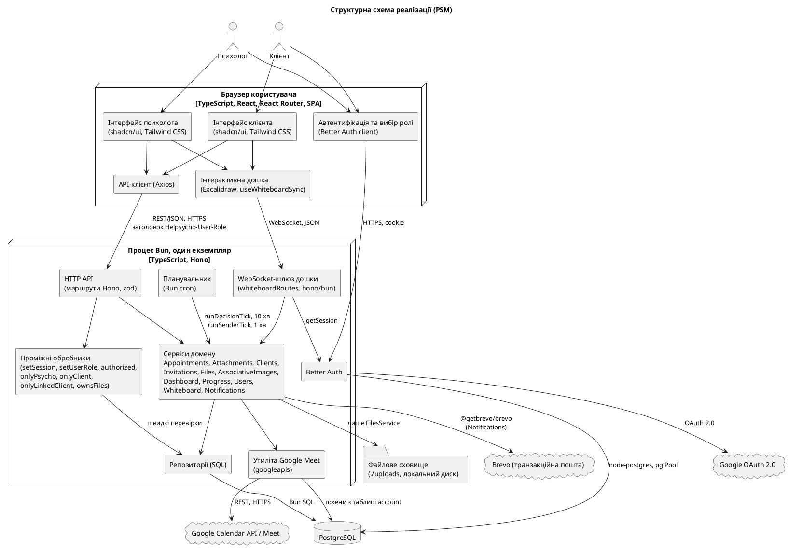

Рисунок 3.1 – Структурна схема реалізації сервісу підтримки віддаленої роботи психолога

Таблиця 3.1 – Відповідність компонентів уточненої архітектури (розділ 2) і реалізації

| Компонент розділу 2 | Реалізація в коді | Підрозділ |
| ----- | ----- | ----- |
| HTTP API | Застосунок Hono (config/app.ts), роутери features/*/routes.ts | 3.3.1 |
| Auth Service | Better Auth (utils/auth.ts) та проміжні обробники (middlewares/auth.ts) | 3.3.1 |
| Users Service | UsersService, UsersRepo | 3.3.1 |
| Realtime Connection Gateway | whiteboardRoutes (upgradeWebSocket), кімнати в памʼяті процесу | 3.3.2 |
| Session Service | AppointmentsService, AppointmentsRepo, WhiteboardService (стан дошки), утиліта google-meet | 3.3.2, 3.3.3 |
| Attachment Service | AttachmentsService, AttachmentCheck | 3.3.4 |
| Notification Service | NotificationsService, producers, definitions, templates, emailService | 3.3.5 |
| Scheduler (cron) | registerNotificationCrons (Bun.cron) | 3.3.5 |
| Client Service, Invitation Service | ClientsService, InvitationsService | 3.3.6 |
| File Storage Service, Associative Image Service | FilesService, AssociativeImagesService | 3.3.7 |
| Dashboard Service, Progress Service | DashboardService, ProgressService | 3.3.8 |
| Компоненти даних | Таблиці PostgreSQL, файли в каталозі uploads | 3.3.9 |

Клієнтську частину розгорнуто у вузлі «Браузер користувача». Компонент автентифікації та вибору ролі відповідає за вхід через Google. Два рольові інтерфейси – психолога і клієнта – реалізують екрани кабінетів, обидва використовують спільну інтерактивну дошку та спільний API-клієнт (Axios), через який проходять усі REST-запити; дошка підключається до сервера окремим WebSocket-зʼєднанням.

Серверну частину розгорнуто в одному процесі Bun, який поєднує чотири складові: HTTP API, WebSocket-шлюз дошки, внутрішньопроцесний планувальник і бібліотеку автентифікації. HTTP API приймає запити, пропускає їх через проміжні обробники й викликає рівно один метод доменного сервісу. Проміжні обробники для швидких перевірок звертаються до репозиторіїв напряму. Сервіси працюють з даними через шар репозиторіїв, який виконує параметризований SQL через Bun SQL. Better Auth окремо підключається до тієї ж бази через драйвер node-postgres. Утиліта Google Meet читає токени Google з таблиці account і звертається до Google Calendar API. Файли зберігаються на локальному диску, і лише FilesService працює з цим сховищем.

Із зовнішніх систем використано три канали: Google OAuth 2.0 (вхід), Google Calendar API (події з Meet) і Brevo (листи). Одноекземплярне розгортання (один процес Bun) є свідомим обмеженням: планувальник, кімнати дошки та файлове сховище не поділяються між репліками, тому декілька копій процесу призвели б до дублювання листів, розсинхронізації кімнат і неузгодженості файлів. Для передбачуваного навантаження такого розгортання достатньо, а експлуатація спрощується.

## 3.3 Розробка компонентів сервісу підтримки віддаленої роботи психолога

Підрозділи 3.3.2–3.3.5 реалізують пакети, детально спроєктовані в підрозділах 2.6.1–2.6.4, у тому самому порядку: «Проведення сесії» (3.3.2), «Планування сесій» (3.3.3), «Керування вкладеннями» (3.3.4), «Надсилання сповіщень» (3.3.5). Підрозділ 3.3.1 описує наскрізну інфраструктуру сервера, підрозділи 3.3.6–3.3.8 – решту пакетів розділу 2 (клієнти й запрошення, файли й асоціативні зображення, дашборди й прогрес), підрозділ 3.3.9 – фізичну модель бази даних, підрозділ 3.3.10 – загальну діаграму класів. Серверний код організовано за предметними модулями: кожен модуль у каталозі features містить маршрути, сервіс і репозиторій, які експортуються як заморожені константні обʼєкти (AppointmentsService, AppointmentsRepo тощо). Відповідність функціональних вимог з додатка В підрозділам реалізації наведено в таблиці 3.2.

Таблиця 3.2 – Відповідність функціональних вимог підрозділам розділу 3

| № | Вимога | Підрозділ | Ключові елементи реалізації |
| ----- | ----- | ----- | ----- |
| 1 | Інтерактивна дошка | 3.3.2, 3.4 | whiteboardRoutes, useWhiteboardSync |
| 2 | Автентифікація через Google OAuth, ролі | 3.3.1 | Better Auth, setUserRole, onlyPsycho, onlyClient |
| 3 | Планування сесій з посиланням Google Meet | 3.3.3 | AppointmentsService.createForPsycho |
| 4 | Приєднання до сесії в реальному часі | 3.3.2, 3.3.3 | startForPsycho, перевірка в шлюзі дошки |
| 5 | Додавання клієнтів через запрошення | 3.3.6 | InvitationsService |
| 6 | Асоціативні зображення на дошці | 3.3.2, 3.3.7 | WhiteboardImageInsert, AssociativeImagesService |
| 7 | Приватні нотатки психолога | 3.3.4 | AttachmentsService, тип note |
| 8 | Рекомендації для клієнта | 3.3.4 | AttachmentsService, тип recommendation |
| 9 | Медіа у вкладеннях | 3.3.4, 3.3.7 | attachment_files, FilesService |
| 10 | Керування асоціативними зображеннями | 3.3.7 | AssociativeImagesService |
| 11 | Вибір активної ролі | 3.3.1 | UsersService.setActiveRole, сторінка входу |
| 12 | Перегляд майбутніх сесій | 3.3.3, 3.3.8 | APPOINTMENT_STATUS_EXPR, DashboardService |
| 13 | Синхронізація та збереження стану дошки | 3.3.2 | WhiteboardService, відкладене збереження |
| 14 | Інтеграція з Google Calendar | 3.3.3 | утиліта google-meet |
| 15 | Враження після сесії | 3.3.4 | AttachmentsService, тип impression |
| 16 | Реакція клієнта на рекомендації | 3.3.4 | recommendation_reactions |
| 17 | Нагадування електронною поштою | 3.3.5 | email_outbox, Bun.cron |
| 18 | Дашборд психолога, профіль клієнта | 3.3.6, 3.3.8 | ClientsService, DashboardService |
| 19 | Відповідь психолога на реакцію | 3.3.4 | replyToRecommendationForPsycho |
| 20 | Кабінет і дашборд клієнта | 3.3.8 | DashboardService |
| 21 | Прогрес клієнта у вигляді хронології | 3.3.8 | ProgressService |
| 22 | Відключення клієнта | 3.3.6 | disconnected_at, ClientsService.unlinkForPsycho |
| 23 | Контактні дані клієнта | 3.3.6 | ClientsService.updateProfile |

### 3.3.1 Реалізація серверного застосунку: маршрутизація, автентифікація та розмежування доступу

Маршрути розподілено за призначенням. Шлях /api/clients/... (зокрема /api/clients/:clientId/appointments, /api/clients/:clientId/progress/impressions і /api/clients/:clientId/appointments/:appointmentId/attachments) обслуговує психолога в контексті конкретного клієнта; /api/client/... (dashboard, appointments, progress, вкладення сесії) – клієнта; /api/psycho/... (dashboard, appointments) – психолога без вказання клієнта. Окремо змонтовано /api/users, /api/files, /api/invitations, /api/associative-images, /api/whiteboard (WebSocket) та /api/auth/* (обробник Better Auth). Маршрут /api/clients/me обслуговує клієнта, а решта /api/clients – психолога.

Кожен маршрут виконує визначену послідовність дій: перевірку вхідних даних схемою zod, проходження проміжних обробників, один виклик методу сервісу, формування HTTP-відповіді. Бізнес-перевірки, транзакції й звернення до зовнішніх сервісів виконують сервіси, а SQL – репозиторії. Сервіси викидають помилки-нащадки AppError з кодом, за яким клієнт розрізняє ситуацію (таблиця 3.3); єдиний обробник onError перетворює їх на JSON-відповідь {error, message}. Непередбачені помилки повертаються зі статусом 500, а трасування стеку приховується, якщо ENV дорівнює production.

Ланцюжок обробки запиту показано на рисунку 3.2. Для всіх маршрутів, окрім /api/auth/*, спочатку виконуються два глобальні обробники. Обробник setSession зчитує сеанс Better Auth за cookie. Обробник setUserRole читає заголовок Helpsycho-User-Role; значення psycho або client приймаються, відсутній заголовок означає запит без ролі, будь-яке інше значення відхиляється з кодом 400 InvalidRole (ще до перевірки автентифікації). Якщо є і сеанс, і заголовок, роль із заголовка порівнюється з полем active_role користувача в базі, а за розбіжності повертається 403 RoleMismatch (листинг Р.1). Далі на рівні роутера guard authorized відхиляє запити без сеансу (401), а onlyPsychoRequest або onlyClientRequest – запити з невідповідною роллю (403). Для маршрутів GET, PUT і DELETE /api/clients/:clientId обробник onlyLinkedClient перевіряє активний зв’язок психолога з клієнтом і повертає 404, щоб не розкривати існування чужих даних; в інших маршрутах з параметром :clientId (сесії, вкладення, прогрес) цю перевірку виконують сервіси. Для маршрутів створення й редагування вкладень після zod-валідації виконується ownsFiles: усі ідентифікатори файлів у тілі запиту має завантажити той самий користувач. Також для вкладень діє обмеження розміру тіла запиту 512 КБ.

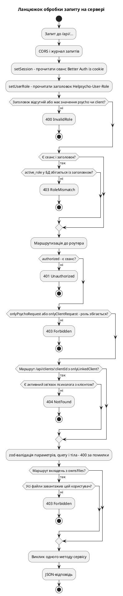

Рисунок 3.2 – Діаграма діяльності обробки запиту на сервері

Таблиця 3.3 – Основні коди помилок, за якими клієнт розрізняє ситуації

| Код | Статус | Умова |
| ----- | ----- | ----- |
| InvalidRole, RoleMismatch | 400, 403 | некоректний заголовок ролі; роль не збігається з active_role |
| Unauthorized, Forbidden, NotFound | 401, 403, 404 | немає сеансу; невідповідна роль; запис відсутній або чужий |
| ClientNotLinked, PsychoNotLinked | 400 | немає чинного зв’язку психолога з клієнтом |
| AppointmentConflict | 409 | перетин із іншою сесією (у деталях – учасник конфлікту) |
| AppointmentNotEditable, AppointmentNotDeletable | 400 | редагування чи видалення сесії не в статусі upcoming |
| AppointmentNotStartable, AppointmentNotEndable, AnotherAppointmentActive | 400 | недопустимий початок чи завершення; у психолога вже є активна сесія |
| MeetRescheduleFailed | 502 | не вдалося оновити подію Google Calendar |
| AppointmentNotActive, AppointmentNotStarted | 400 | створення вкладення для майбутньої сесії (психолог, клієнт) |
| AttachmentLimitReached | 400 | перевищено ліміт вкладень (15, 10, 10) |
| RecommendationHasReaction, ImpressionHasCompletion | 409 | видалення вкладення, що має реакцію або відповідь |
| ReplyAlreadySet, CommentAlreadySet, AlreadyCompleted | 400 | повторна одноразова відповідь |
| FileTooLarge, UnsupportedFileType, BodyTooLarge | 400 | файл завеликий; формат не з переліку; завелике тіло запиту |
| FileNotOwned | 403 | файл бібліотеки зображень належить іншому користувачу |
| ClientNotFound, AlreadyLinked, SelfLinkNotAllowed | 400 | додавання клієнта за e-mail |
| EmailMismatch, AlreadyAccepted, InvalidStatus | 400 | прийняття або видалення запрошення |

Автентифікацію виконує Better Auth із провайдером Google. Налаштування провайдера (prompt consent, режим доступу offline) запитують дозвіл calendar.events, щоб сервер міг створювати події календаря від імені психолога, а сторінка входу психолога передає цей дозвіл додатково. Токени зберігаються в таблиці account. Сеанс передається cookie з атрибутами httpOnly та sameSite=lax (у виробничому режимі – з secure). Після створення користувача тригер бази даних створює рядки профілів психолога і клієнта, а роль користувач обирає вже на сторінці входу до переходу в Google: вибір запамʼятовується в sessionStorage й після повернення на сторінку /auth/callback записується в active_role запитом PATCH /api/users/me/role (рисунок 3.3). Якщо користувач входить за посиланням запрошення, роль client встановлюється автоматично і запрошення приймається. Запасний екран /role-select відкривається, коли роль ще не вибрано. Поки роль не задано, запити без заголовка дозволяються, а запити, що вимагають ролі, відхиляються. Роль можна змінити з бічної панелі, але не під час активної сесії.

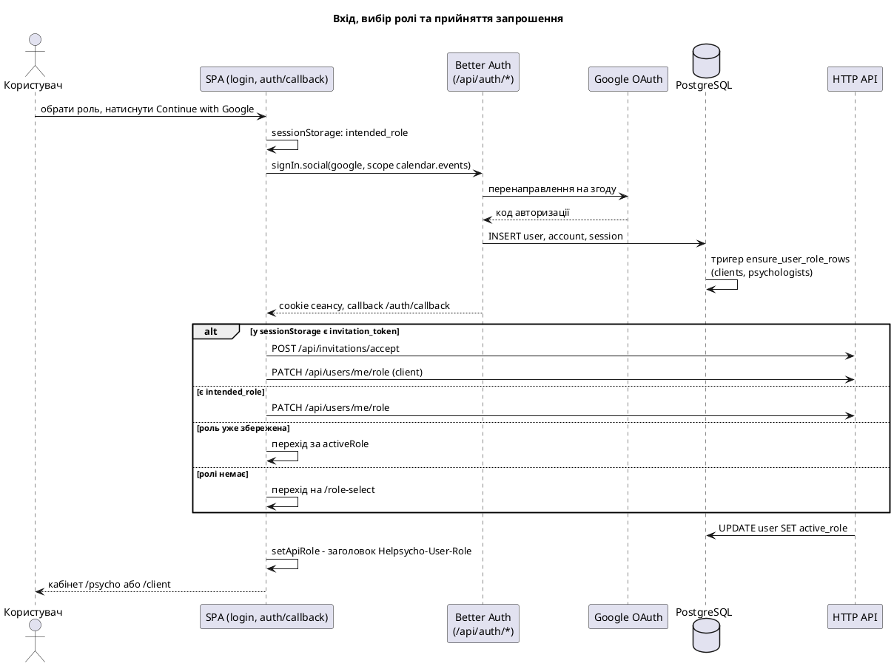

Рисунок 3.3 – Діаграма послідовності входу та вибору ролі

На стороні клієнта Axios-екземпляр додає заголовок Helpsycho-User-Role до кожного запиту й перехоплює відповіді: статус 401 викликає подію виходу, а 403 з кодом RoleMismatch – повторне завантаження профілю користувача. На рисунку 3.4 показано локальну діаграму класів інфраструктурного шару: ієрархію помилок і набір проміжних обробників.

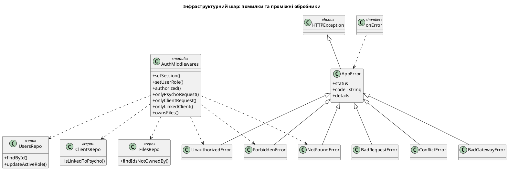

Рисунок 3.4 – Локальна діаграма класів інфраструктурного шару

### 3.3.2 Реалізація проведення сесії: інтерактивна дошка та обмін даними в реальному часі

Підрозділ реалізує пакет «Проведення сесії» (підрозділ 2.6.1, додаток К). Дошка працює через WebSocket-шлюз за адресою /api/whiteboard/:appointmentId (whiteboardRoutes, модуль whiteboard). Шлюз окремо читає сеанс Better Auth із cookie зʼєднання й закриває його з кодом 1008, якщо сеансу немає (причина Unauthorized), користувач не є учасником сесії (NotFound) або сесія не має статусу «активна» (AppointmentNotActive). Для кожної сесії сервер тримає в памʼяті кімнату з множиною зʼєднань і поточним станом сцени (елементи й файли). Перший учасник завантажує стан із колонок whiteboard_elements та whiteboard_files, наступні отримують його з памʼяті; кожне нове зʼєднання отримує повідомлення scene_init. Якщо ініціалізація кімнати завершується помилкою, зʼєднання закривається з кодом 1011.

Протокол складається з трьох типів вхідних повідомлень: elements (повний масив елементів сцени, що замінює поточний), files (нові вбудовані зображення, які додаються до наявних) та cursor (координати вказівника). Повідомлення, які не вдалося розібрати, ігноруються. Сервер змінює стан у памʼяті, ретранслює повідомлення всім учасникам, окрім відправника, а для elements та files відкладено зберігає стан у базу: таймер у 3 секунди скидається при кожній зміні, тож запис виконується після паузи. Координати курсору доповнюються ідентифікатором і імʼям користувача й не зберігаються. Коли з кімнати виходить останній учасник, відкладений запис (якщо він очікується) виконується негайно, а кімната вивантажується з памʼяті (рисунок 3.5; фрагмент коду – додаток Р, листинг Р.2). Сесія залишається активною, доки психолог не завершить її, тому учасник може підключитися знову й отримати збережений стан. Автоматичного перепідключення клієнтський хук не виконує: після розриву зʼєднання прапорець connected скидається, курсори очищуються, а для відновлення потрібно знову відкрити сторінку сесії.

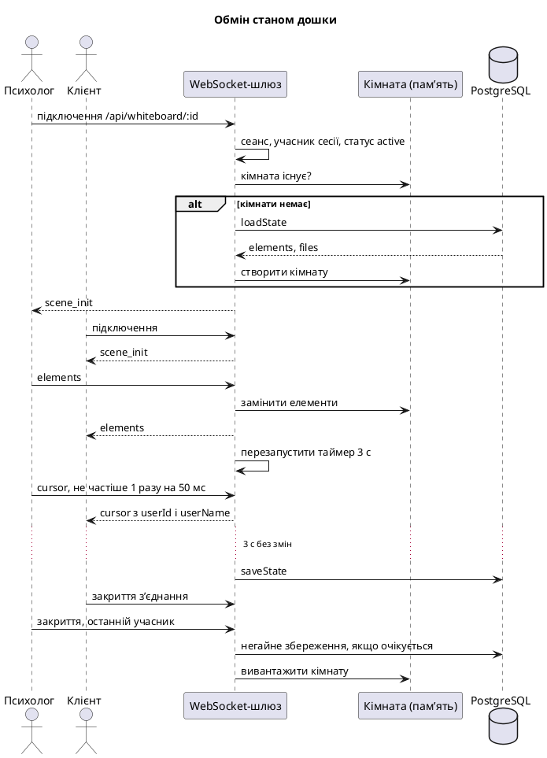

Рисунок 3.5 – Діаграма послідовності обміну станом інтерактивної дошки

На клієнті хук useWhiteboardSync зʼєднує Excalidraw із WebSocket. Позицію курсору він надсилає не частіше ніж раз на 50 мс. Щоб уникнути нескінченного циклу ретрансляції, клієнт порівнює підпис масиву елементів (пари «ідентифікатор@версія») з підписом останнього віддаленого оновлення й не повертає їх назад; порожні масиви елементів не надсилаються, бо вони є артефактами ініціалізації й стерли б стан на сервері; вбудовані файли надсилаються лише один раз для кожного ідентифікатора. Якщо повідомлення scene_init надійшло раніше, ніж Excalidraw готовий, сцену буферизують і застосовують наступного кадру. Алгоритм обробки локальної зміни наведено на рисунку 3.6.

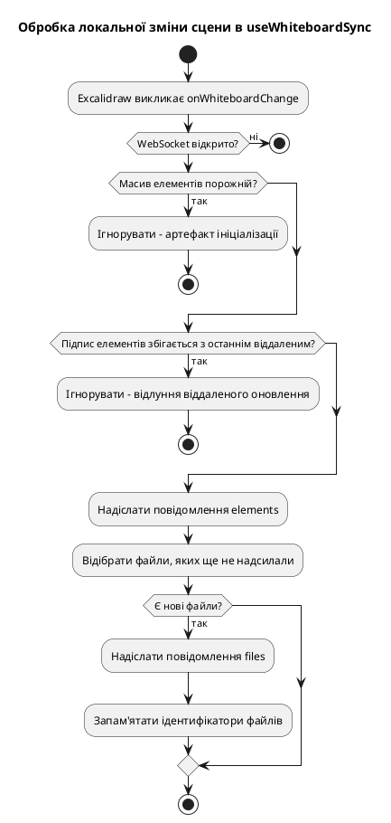

Рисунок 3.6 – Діаграма діяльності обробки локальної зміни сцени

Завершення сесії виконує лише психолог (підрозділ 3.3.3). Перед запитом на завершення клієнт формує знімок дошки (exportToBlob, формат PNG), перетворює його на data URL і передає в тілі запиту; після завершення сервер очищує збережений стан дошки. Асоціативне зображення з бібліотеки психолога вставляється так: компонент WhiteboardImageInsert завантажує файл через /api/files, перетворює його на data URL, додає до Excalidraw як вбудований файл, і далі зображення поширюється повідомленнями files та elements так само, як будь-який інший елемент. Тому клієнту не потрібен прямий доступ до файла бібліотеки. На рисунку 3.7 показано локальну діаграму класів модуля дошки.

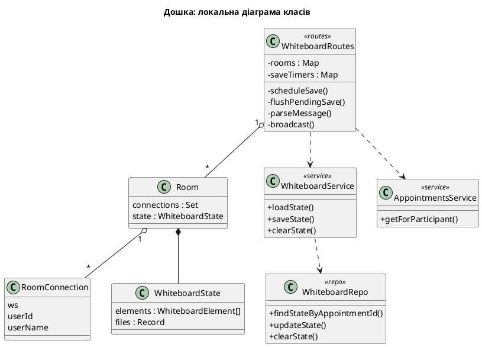

Рисунок 3.7 – Локальна діаграма класів модуля інтерактивної дошки

### 3.3.3 Реалізація планування сесій та інтеграції з Google Meet

Підрозділ реалізує пакет «Планування сесій» (підрозділ 2.6.2). Сервіс AppointmentsService реалізує життєвий цикл сесії: створення, редагування, видалення, початок і завершення. Алгоритм створення наведено на рисунку 3.8. Спочатку перевіряється, що час завершення пізніший за час початку, і що клієнт привʼязаний до психолога (інакше 400 ClientNotLinked). Далі в транзакції беруться консультативні блокування pg_advisory_xact_lock для обох учасників (у впорядкованому вигляді, щоб уникнути взаємного блокування), перевіряється відсутність перетину і вставляється рядок сесії (листинг Р.4). Перетином вважається сесія, яка перетинається в часі та в якій будь-хто з двох учасників бере участь у будь-якій ролі: психолог, що є клієнтом в іншій сесії, також отримає конфлікт. Лише після завершення транзакції, якщо психолог обрав генерацію Google Meet, сервіс викликає Google Calendar API. Збій цього виклику не скасовує сесію: відповідь містить ознаку meetLinkGenerationFailed, а психолог згодом може додати посилання вручну. Якщо після успішного створення події не вдалося записати посилання в базу, подію календаря видаляють (компенсація), а помилка повертається. Це реалізує нефункціональну вимогу доступності: створення сесії не залежить від зовнішніх сервісів.

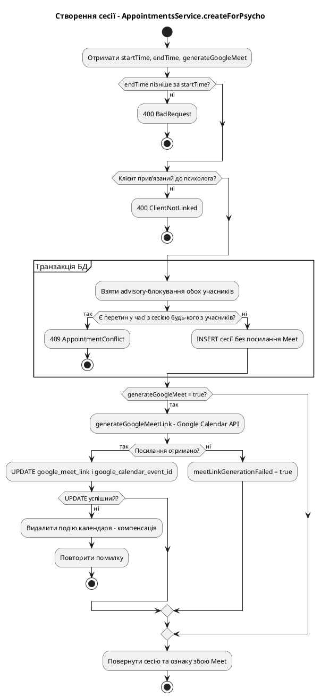

Рисунок 3.8 – Діаграма діяльності створення сесії

Редагування (PATCH) дозволено лише для сесій зі статусом upcoming (інакше 400 AppointmentNotEditable); нові значення зливаються з наявними, після чого повторно перевіряються порядок часу й відсутність перетину. Якщо психолог просить перенести подію в календарі (rescheduleGoogleMeet), сервіс спочатку оновлює подію в Google Calendar, і коли оновлення не вдалося, зміну скасовано з помилкою 502 MeetRescheduleFailed, щоб база і календар не розходилися; для сесії без події календаря створюється нова подія з посиланням. Запис у базу виконується в транзакції під тими самими блокуваннями, що й створення. Якщо запис не вдався, сервіс повертає подію календаря до старого часу або видаляє щойно створену подію (рисунок 3.9). Видалення дозволено лише для сесій зі статусом upcoming; сервіс видаляє подію календаря, але збій цього виклику лише повертається прапорцем meetDeleteFailed і не блокує видалення.

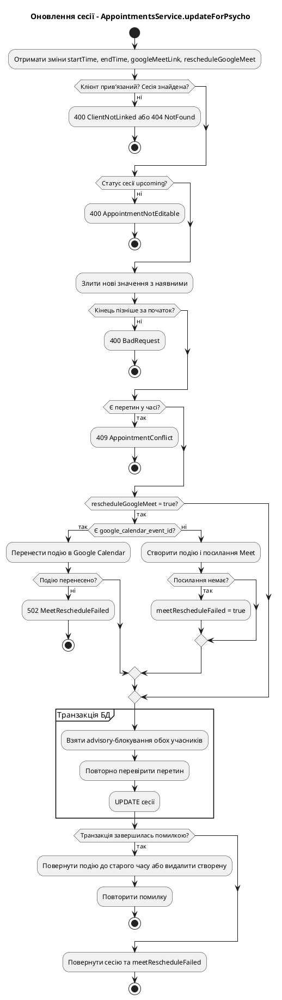

Рисунок 3.9 – Діаграма діяльності оновлення сесії

Статус сесії не зберігається, а обчислюється SQL-виразом CASE із полів started_at, ended_at, start_time та end_time (листинг Р.3): «минула» (past) – є обидві фактичні позначки; «активна» (active) – є лише started_at; «майбутня» (upcoming) – поточний час раніше початку; «потребує уваги» (warning) – час початку минув, але не пізніше за час завершення; «пропущена» (missed) – інакше. Перехід між станами показано на рисунку 3.10. Початок сесії виконується в транзакції під тими самими блокуваннями; допустимо починати сесії зі статусами upcoming та warning, а якщо в психолога вже є активна сесія, повертається 400 AnotherAppointmentActive. Тому в психолога одночасно є не більше однієї активної сесії. Завершення виконує лише психолог: у транзакції записується ended_at і знімок дошки, потім стан дошки очищується. Перевірку зв’язку при завершенні свідомо не виконано, щоб активну сесію можна було завершити, навіть якщо клієнта відключили під час сесії. Допустимі операції залежно від статусу наведено в таблиці 3.4, а структуру модуля – на рисунку 3.11.

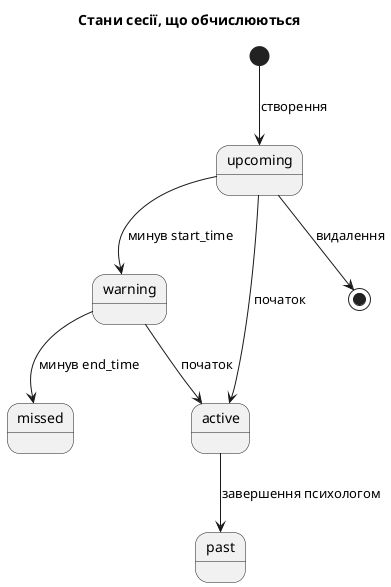

Рисунок 3.10 – Діаграма станів сесії

Таблиця 3.4 – Допустимі операції залежно від статусу сесії

| Операція | upcoming | warning | missed | active | past |
| ----- | ----- | ----- | ----- | ----- | ----- |
| Редагування, видалення | так | ні | ні | ні | ні |
| Початок | так | так | ні | ні | ні |
| Завершення | ні | ні | ні | так | ні |
| Створення вкладень | ні | так | так | так | так |
| Підключення до дошки | ні | ні | ні | так | ні |

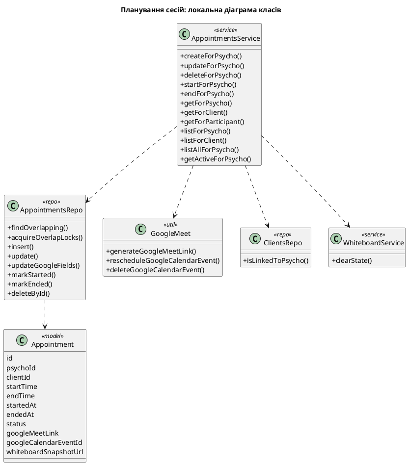

Рисунок 3.11 – Локальна діаграма класів модуля сесій

Перегляд сесій реалізовано окремими роутерами: психолог бачить сесії клієнта (/api/clients/:clientId/appointments), усі свої сесії з кількістю вкладень (/api/psycho/appointments/all, лише для активних клієнтів) та активну сесію (/api/psycho/appointments), клієнт – власні сесії з імʼям психолога (/api/client/appointments).

### 3.3.4 Реалізація керування вкладеннями

Підрозділ реалізує пакет «Керування вкладеннями» (підрозділ 2.6.3). Нотатки, рекомендації та враження реалізує один AttachmentsService, бо вони мають спільну структуру: назва (до 255 символів), текст (до 65536 символів), автор, привʼязка до сесії та впорядковані файли. Тип вкладення визначає лише права та додаткові дані. Нотатку й рекомендацію створює психолог, враження – клієнт. Створення блокується, лише якщо сесія має статус upcoming (відповіді 400 AppointmentNotActive для психолога та AppointmentNotStarted для клієнта); отже вкладення можна додавати до активної й минулої сесій, а також до сесій зі статусами warning і missed. Кількість вкладень до сесії обмежено константами: 15 нотаток, 10 рекомендацій і 10 вражень. Перевірка лічильника виконується в транзакції створення без додаткового блокування, тож за двох одночасних запитів на межі ліміту ліміт теоретично можна перевищити; для передбачуваного навантаження це припустимо.

Створення виконується в одній транзакції (рисунок 3.12): перевірка ліміту, вставлення вкладення, привʼязка файлів (з видом image чи audio та позицією), а для рекомендації – постановка листа rec_created у чергу email_outbox. Тому лист не втрачається, якщо транзакцію скасовано, і не надсилається для скасованих записів.

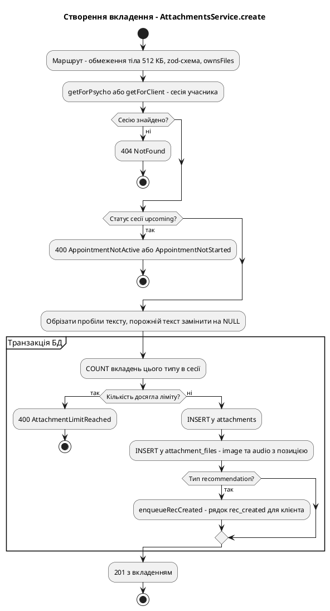

Рисунок 3.12 – Діаграма діяльності створення вкладення

Реакції реалізовано окремими таблицями. Клієнт може позначити рекомендацію виконаною (ознаку done можна перевстановлювати) та один раз залишити коментар (повторний коментар – 400 CommentAlreadySet); психолог може один раз відповісти (400 ReplyAlreadySet). Для вражень передбачено одноразову відповідь клієнта (таблиця impression_completions, маршрут complete); відповідний екран інтерфейсу наразі не реалізовано, тому цю можливість доступно лише через API. Для перевірок прав використано будівельник AttachmentCheck: він послідовно перевіряє приналежність сесії користувачу, правила за типом вкладення (setTypeRules), очікуваний тип і автора та повертає вкладення разом з реакцією чи відповіддю. Недозволений доступ повертає 404, щоб не розкривати чужі записи. Структуру модуля показано на рисунку 3.13. Видалення рекомендації заборонено (409 RecommendationHasReaction), якщо для неї існує запис реакції (його створює як реакція клієнта, так і відповідь психолога); видалення враження заборонено (409 ImpressionHasCompletion), якщо існує його completion. Нотатку автор може видалити завжди. Після видалення або редагування файли, на які більше ніхто не посилається, видаляються з диска (підрозділ 3.3.7). Клієнт не отримує нотаток: запит клієнта на нотатку повертає 404.

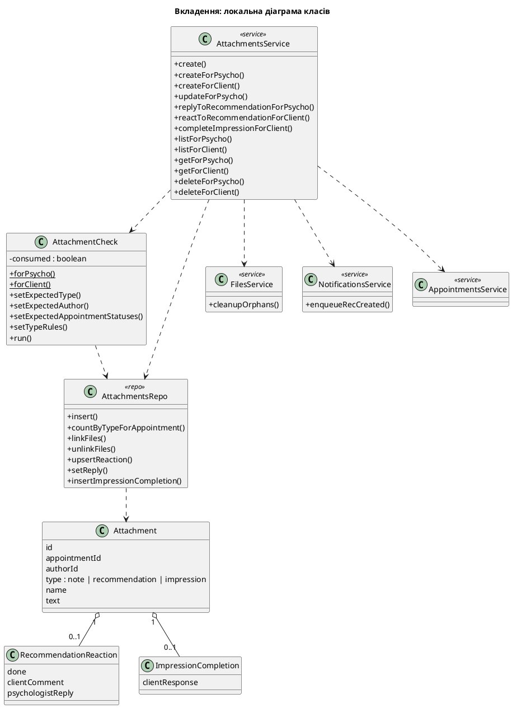

Рисунок 3.13 – Локальна діаграма класів модуля вкладень

Діаграму обʼєктів на рисунку 3.14 побудовано для прикладного стану: у завершеної сесії є рекомендація з одним зображенням, на яку клієнт уже відреагував, і поставлений у чергу лист. Вона ілюструє, як одна сутність «Вкладення» поєднується з файлом через проміжну таблицю та розширюється необов’язковою реакцією.

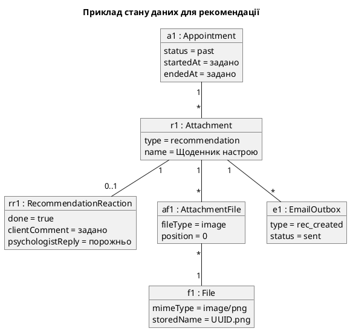

Рисунок 3.14 – Діаграма обʼєктів для вкладення-рекомендації

### 3.3.5 Реалізація надсилання сповіщень та черги поштових сповіщень

Підрозділ реалізує пакет «Надсилання сповіщень» (підрозділ 2.6.4, додаток Ж). Пакет реалізує шаблон «транзакційна скринька вихідних» (transactional outbox). Листи не надсилаються безпосередньо в місці виникнення події: спочатку в таблицю email_outbox записується рядок зі станом pending, а потім окремий цикл його надсилає. Є два типи джерел: події (rec_created під час створення рекомендації, invitation_created під час створення запрошення), що ставляться в чергу в тій самій транзакції, та планові нагадування, які породжує cron. Види листів наведено в таблиці 3.5.

Таблиця 3.5 – Види листів черги

| Тип | Варіанти | Отримувач | Коли ставиться в чергу | Неактуальний, якщо |
| ----- | ----- | ----- | ----- | ----- |
| session_reminder | 24h, 1h | клієнт і психолог | cron: сесія не розпочата, початок у смузі варіанта | сесія розпочата або видалена |
| rec_reminder | 2d, 1d | клієнт | cron: до наступної сесії у смузі варіанта клієнт має невиконану рекомендацію з попередньої сесії з тим самим психологом | сесія розпочата або видалена |
| rec_created | немає | клієнт | у транзакції створення рекомендації | перевірку не виконують |
| invitation_created | немає | адреса запрошеного | у транзакції створення запрошення | запрошення вже не очікує |

Bun.cron запускає два завдання (src/index.ts викликає registerNotificationCrons). Тік рішення виконується кожні 10 хвилин (рисунок 3.15): для кожного варіанта кожного планового виробника виконується SQL-запит кандидатів у «смузі» варіанта (наприклад, для 24h – початок через від однієї до двадцяти чотирьох годин), щоб сесія, створена менш ніж за добу до початку, не отримала також ширше нагадування; для кожного кандидата в чергу додається рядок. Повторні тіки безпечні двічі: запит кандидатів виключає пари, для яких рядок уже є (NOT EXISTS), а унікальний індекс за виразами та INSERT ... ON CONFLICT DO NOTHING відкидають дублікати (листинг Р.5). Тік надсилання виконується щохвилини (рисунок 3.16): бере до 50 рядків pending з attempts менше трьох, для кожного через реєстр DEFINITIONS отримує свіжий контекст, перевіряє актуальність і лише тоді відображає шаблон і передає лист Brevo. Успіх позначає sent, відсутній контекст або неактуальний лист – skipped, помилка збільшує лічильник спроб і після третьої спроби переводить рядок у failed (листинг Р.6); до того рядок лишається pending і повторюється на наступному тіку. Тіки перехоплюють власні помилки, щоб збій не зупинив планувальник. Додавання нового типу листа потребує запису в NotificationType, DEFINITIONS і templates, а для планового – і запису в SCHEDULED; тік надсилання змінювати не потрібно. Листи містять час за київським часом. Якщо змінна EMAIL_ENABLED не дорівнює true (наприклад, у розробці та тестах), emailService лише записує лист у журнал. Стани запису черги показано на рисунку 3.17, структуру модуля – на рисунку 3.18.

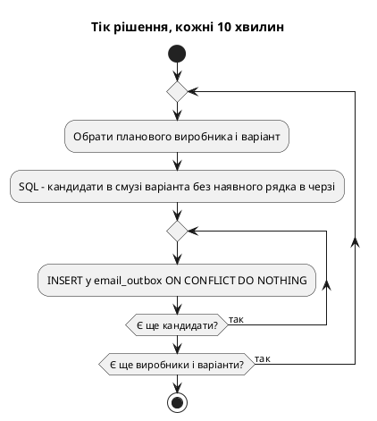

Рисунок 3.15 – Діаграма діяльності етапу прийняття рішень

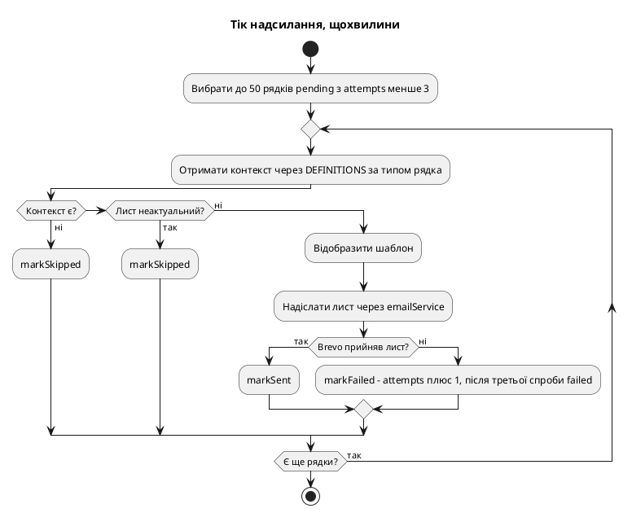

Рисунок 3.16 – Діаграма діяльності етапу надсилання

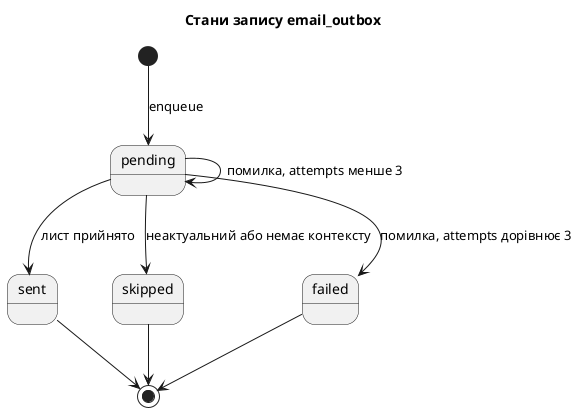

Рисунок 3.17 – Діаграма станів запису черги листів

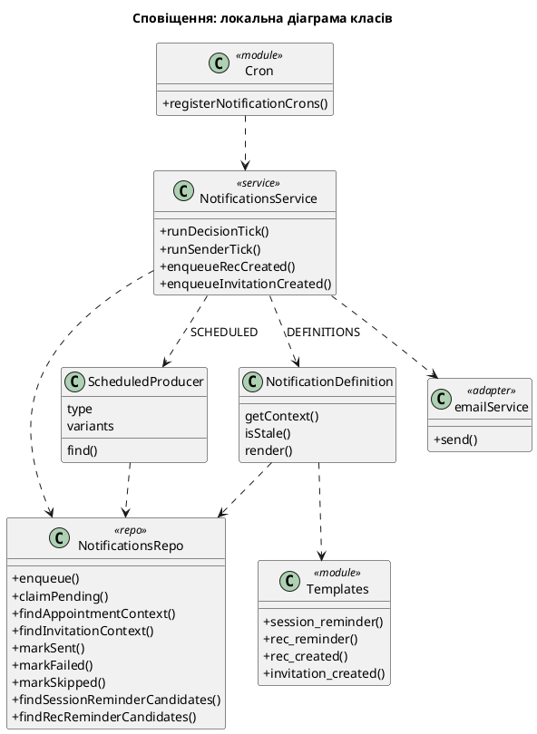

Рисунок 3.18 – Локальна діаграма класів модуля сповіщень

### 3.3.6 Реалізація керування клієнтами та запрошеннями

Підрозділ реалізує пакети «Управління клієнтами» та «Створення запрошення» з підрозділу 2.7. Зв’язок психолога з клієнтом створюється двома способами. Якщо клієнт уже зареєстрований, психолог додає його за адресою електронної пошти (ClientsService.linkByEmailToPsycho): помилки ClientNotFound, SelfLinkNotAllowed, AlreadyLinked. Якщо ні – психолог створює запрошення. InvitationsService.createForPsycho нормалізує адресу (нижній регістр), відхиляє власну адресу та вже привʼязаного клієнта, повертає наявне очікуване запрошення замість створення дубліката, а інакше в одній транзакції вставляє запрошення й ставить у чергу лист invitation_created. Запрошення має унікальний токен і посилання виду /invite?token=...; строку дії запрошення немає.

Прийняття запрошення виконує InvitationsService.acceptByToken (рисунок 3.19): перевіряються наявність токена, статус, збіг адреси з адресою поточного користувача (EmailMismatch), заборона прийняття власного запрошення та відсутність чинного зв’язку; після цього в транзакції запрошення позначається прийнятим, а зв’язок створюється. На клієнті сторінка /invite зберігає токен у sessionStorage, перенаправляє на вхід через Google, а після повернення викликає прийняття й вибирає роль client.

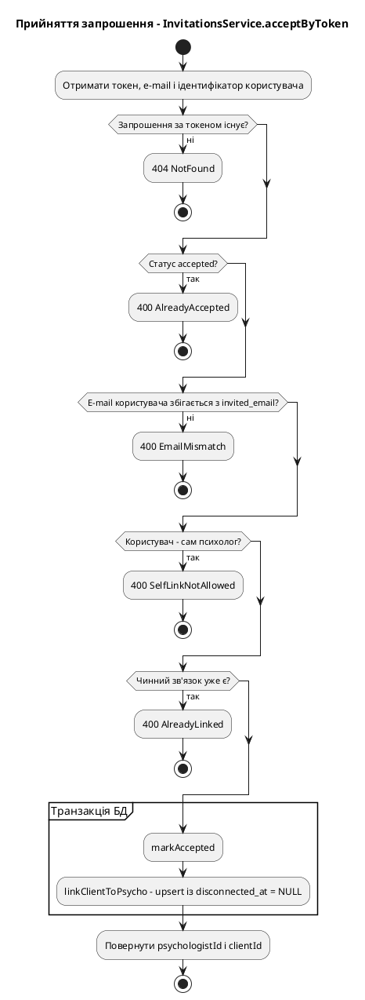

Рисунок 3.19 – Діаграма діяльності прийняття запрошення

Зв’язок зберігається у таблиці psychologist_clients, а відключення (ClientsService.unlinkForPsycho) лише записує час у disconnected_at, тож історія сесій і вкладень зберігається. Відключений клієнт зникає зі списку клієнтів, а психолог не може переглядати чи змінювати його профіль і сесії (відповіді 404 або ClientNotLinked); завершити активну сесію з таким клієнтом психолог усе ж може. Повторне запрошення або додавання виконує upsert, який скидає disconnected_at, і колишні сесії знову стають доступними. Клієнт і далі бачить власні сесії. Контактні дані (імʼя користувача, телефон, Telegram, Instagram) та імʼя можуть змінювати психолог (PUT /api/clients/:clientId) і сам клієнт (PUT /api/clients/me); адреса електронної пошти не змінюється. Профіль клієнта для психолога містить кількість сесій, вражень і рекомендацій, останню завершену та найближчу сесії, причому всі агрегати обмежено поточним психологом.

### 3.3.7 Реалізація роботи з файлами та бібліотекою асоціативних зображень

FilesService приймає завантаження файла до 25 МБ (маршрут обмежує тіло запиту на 1 КБ більше за ліміт файла). Алгоритм завантаження наведено на рисунку 3.20. Тип файла визначається за початковими байтами (таблиця 3.6), а MIME-тип і розширення, надіслані клієнтом, ігноруються, бо Bun перевизначає Content-Type за назвою файла. Файл зберігається під випадковим імʼям UUID з канонічним розширенням у каталозі uploads, а метадані (оригінальна назва, збережена назва, MIME-тип, розмір, завантажувач) записуються в таблицю files. Віддача (GET /api/files/:filename) доступна завантажувачу або учаснику сесії (психологу чи клієнту), до вкладення якої привʼязано файл; в іншому разі повертається 404.

Таблиця 3.6 – Формати файлів, що приймаються

| Формат | Ознака початкових байтів | Розширення |
| ----- | ----- | ----- |
| JPEG | FF D8 FF | .jpg |
| PNG | 89 50 4E 47 0D 0A 1A 0A | .png |
| GIF | 47 49 46 38 | .gif |
| WebP | RIFF, на зміщенні 8 – WEBP | .webp |
| WebM (аудіо) | 1A 45 DF A3 | .webm |
| MP4 (аудіо) | ftyp на зміщенні 4 | .m4a |
| OGG | OggS | .ogg |
| MP3 | ID3 або синхрослово кадру | .mp3 |

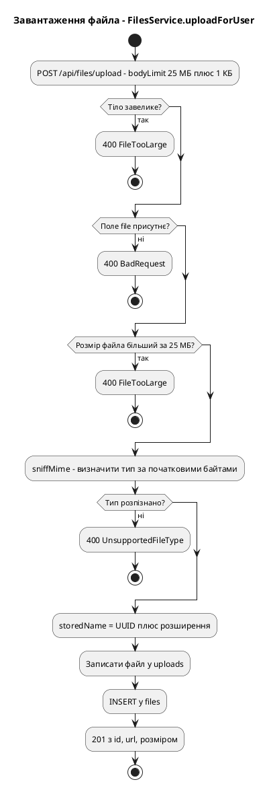

Рисунок 3.20 – Діаграма діяльності завантаження файла

Коли вкладення видаляється або з нього знімають файли, викликається cleanupOrphans у тій самій транзакції: у таблиці files і на диску видаляються лише файли, на які не лишилося посилань ні в attachment_files, ні в associative_images.

Бібліотека асоціативних зображень належить психологу й дозволяє завантажувати (файл має бути завантажений тим самим психологом, інакше 403 FileNotOwned), перейменовувати, шукати за назвою (сторінками по 20, не більше 50) і видаляти зображення. Під час сесії психолог вставляє зображення з бібліотеки на дошку (підрозділ 3.3.2). Файл, на який посилається асоціативне зображення, не можна видалити, доки існує саме зображення: зовнішній ключ associative_images.file_id не має каскаду.

### 3.3.8 Реалізація дашбордів та відстеження прогресу клієнта

Модулі dashboard і progress лише обчислюють подання з наявних даних. DashboardService збирає дані паралельно (Promise.all): для психолога – кількість активних клієнтів, кількість майбутніх і минулих сесій, активну сесію, п’ять найближчих сесій і п’ять останніх клієнтів; для клієнта – список психологів, активну та найближчу сесії, очікувані рекомендації (без реакції або з done = false) та лічильники за статусом. Статуси «потребує уваги» та «пропущена» зводяться до «майбутні» та «минулі». Для клієнта ProgressService повертає завершені сесії з психологом (обраним перемикачем), до кожної з яких додано враження клієнта та рекомендації з реакціями, у порядку зростання часу; якщо психолог не привʼязаний, повертається 400 PsychoNotLinked. Для психолога ProgressService повертає перелік вражень клієнта за всі сесії з часом сесії (400 ClientNotLinked для чужого клієнта). Отже хронологію з рекомендаціями побачить клієнт, а психолог бачить враження.

### 3.3.9 Реалізація бази даних: фізична модель

Фізична модель бази даних (додаток П, рисунок 3.21) реалізує логічну модель підрозділу 2.6.6 у PostgreSQL. Схема створюється послідовністю SQL-міграцій, перелік застосованих міграцій зберігається у таблиці schema_migrations. Первинні ключі мають тип text зі значенням gen_random_uuid() (розширення pgcrypto), усі моменти часу – timestamptz, зовнішні ключі, окрім associative_images.file_id, мають ON DELETE CASCADE. Таблиці Better Auth (user, session, account, verification) створюються бібліотекою окремо від міграцій проєкту; міграції додають до user лише колонку active_role. Разом схема містить 12 доменних таблиць, службову schema_migrations і 4 таблиці Better Auth.

```plantuml
@startuml
hide circle
skinparam linetype ortho
entity "user" as U {
  *id : text <<PK>>
  --
  name
  email : unique
  image
  active_role : psycho, client або NULL
}
entity "session" as S {
  *id : text <<PK>>
  userId : text <<FK>>
}
entity "account" as AC {
  *id : text <<PK>>
  userId : text <<FK>>
  accessToken, refreshToken, scope
}
entity psychologists {
  *user_id : text <<PK, FK>>
}
entity clients {
  *user_id : text <<PK, FK>>
  --
  username, phone, telegram, instagram
}
entity psychologist_clients {
  *client_id : text <<PK, FK>>
  *psycho_id : text <<PK, FK>>
  --
  disconnected_at
}
entity appointments {
  *id : text <<PK>>
  --
  psycho_id : text <<FK>>
  client_id : text <<FK>>
  start_time, end_time
  started_at, ended_at
  google_meet_link
  google_calendar_event_id
  whiteboard_elements : jsonb
  whiteboard_files : jsonb
  whiteboard_snapshot_url
  created_at
}
entity attachments {
  *id : text <<PK>>
  --
  appointment_id : text <<FK>>
  author_id : text <<FK>>
  type : note, recommendation, impression
  name, text
  created_at, updated_at
}
entity files {
  *id : text <<PK>>
  --
  original_name
  stored_name : unique
  mime_type, size
  uploaded_by : text <<FK>>
}
entity attachment_files {
  *id : text <<PK>>
  --
  attachment_id : text <<FK>>
  file_id : text <<FK>>
  file_type : image, audio
  position
}
entity recommendation_reactions {
  *attachment_id : text <<PK, FK>>
  --
  done, client_comment
  psychologist_reply
}
entity impression_completions {
  *attachment_id : text <<PK, FK>>
  --
  client_response
}
entity invitations {
  *id : text <<PK>>
  --
  psychologist_id : text <<FK>>
  invited_email
  token : unique
  status
}
entity associative_images {
  *id : text <<PK>>
  --
  psychologist_id : text <<FK>>
  file_id : text <<FK>>
  name
}
entity email_outbox {
  *id : text <<PK>>
  --
  type, variant
  recipient_user_id : text <<FK>> NULL
  recipient_email NULL
  appointment_id <<FK>> NULL
  attachment_id <<FK>> NULL
  invitation_id <<FK>> NULL
  status, attempts, last_error
  scheduled_for, sent_at
}

U ||--o| psychologists
U ||--o| clients
U ||--o{ S
U ||--o{ AC
U ||--o{ psychologist_clients : client_id
U ||--o{ psychologist_clients : psycho_id
U ||--o{ appointments : psycho_id
U ||--o{ appointments : client_id
U ||--o{ attachments : author_id
U ||--o{ files : uploaded_by
U ||--o{ invitations
U ||--o{ associative_images
U |o--o{ email_outbox
appointments ||--o{ attachments
attachments ||--o{ attachment_files
files ||--o{ attachment_files
attachments ||--o| recommendation_reactions
attachments ||--o| impression_completions
files ||--o{ associative_images
appointments |o--o{ email_outbox
attachments |o--o{ email_outbox
invitations |o--o{ email_outbox
@enduml
```

Рисунок 3.21 – Фізична модель бази даних

Опис таблиць наведено в таблицях 3.7–3.9. Обмеження цілісності частково закріплено декларативно: CHECK на значення active_role, type вкладення, file_type, заборона зв’язку користувача із самим собою в psychologist_clients та appointments, первинні ключі reactions та completions, що гарантують не більше однієї реакції чи відповіді. Натомість порядок часу сесії (кінець пізніший за початок) і ліміти вкладень перевіряються сервісами. Порівняно з логічною моделлю підрозділу 2.6.6 таблиця email_outbox розширена: колонки recipient_email та invitation_id і дозвіл порожнього recipient_user_id потрібні для листів-запрошень, адресат яких ще не має облікового запису; CHECK email_outbox_recipient_present вимагає наявності хоча б одного адресата.

Таблиця 3.7 – Опис таблиць автентифікації, профілів і зв’язків

| Таблиця | Колонки | Ключі, індекси, обмеження | Призначення |
| ----- | ----- | ----- | ----- |
| user | id text; name; email; image; createdAt; active_role text (psycho або client, за замовчуванням NULL) та інші службові колонки Better Auth | PK id; email унікальний; CHECK на active_role | обліковий запис; створює Better Auth, проєкт додає active_role |
| session | id; userId; токен і строк дії | PK id; FK userId | сеанси входу, керує бібліотека |
| account | id; userId; providerId; accessToken; refreshToken; accessTokenExpiresAt; scope | PK id; FK userId | зв’язок із Google, токени для Calendar API |
| verification | службові колонки Better Auth | керує бібліотека | тимчасові верифікаційні значення |
| psychologists | user_id text | PK і FK на user (CASCADE) | профіль психолога, створює тригер user_role_rows |
| clients | user_id text; username; phone; telegram; instagram (усі, крім ключа, необов’язкові) | PK і FK на user (CASCADE) | профіль клієнта з контактними даними |
| psychologist_clients | client_id; psycho_id; disconnected_at timestamptz (NULL) | складений PK (client_id, psycho_id); FK на user; CHECK client_id не дорівнює psycho_id | зв’язок «багато до багатьох»; disconnected_at зберігає історію |
| schema_migrations | name varchar(255); applied_at timestamptz | PK name | перелік застосованих міграцій |

Таблиця 3.8 – Опис таблиць сесій, вкладень і файлів

| Таблиця | Колонки | Ключі, індекси, обмеження | Призначення |
| ----- | ----- | ----- | ----- |
| appointments | id; psycho_id; client_id (обидва NOT NULL); start_time; end_time (NOT NULL); started_at; ended_at; google_meet_link; google_calendar_event_id; whiteboard_elements jsonb; whiteboard_files jsonb; whiteboard_snapshot_url text; created_at | PK id; FK psycho_id і client_id на user (CASCADE); CHECK psycho_id не дорівнює client_id; індекс (psycho_id, client_id) | сесія; колонки статусу немає, він обчислюється; стан дошки зберігається в jsonb |
| attachments | id; appointment_id; author_id; type; name (NOT NULL); text; created_at; updated_at | PK id; FK на appointments і user (CASCADE); CHECK type; індекси (appointment_id, type) та author_id | нотатки, рекомендації та враження |
| files | id; original_name; stored_name; mime_type; size bigint; uploaded_by; created_at | PK id; stored_name унікальний; FK uploaded_by на user (CASCADE) | метадані завантажених файлів; самі файли – на диску |
| attachment_files | id; attachment_id; file_id; file_type; position int (за замовчуванням 0); created_at | PK id; FK на attachments і files (CASCADE); CHECK file_type (image, audio); індекс attachment_id | зв’язок вкладення з файлами, вид і порядок |
| recommendation_reactions | attachment_id; done boolean (false); client_comment; psychologist_reply; updated_at | PK і FK attachment_id (CASCADE) | не більше однієї реакції на рекомендацію |
| impression_completions | attachment_id; client_response (NOT NULL); created_at | PK і FK attachment_id (CASCADE) | не більше однієї відповіді на враження |

Таблиця 3.9 – Опис таблиць запрошень, бібліотеки зображень і черги листів

| Таблиця | Колонки | Ключі, індекси, обмеження | Призначення |
| ----- | ----- | ----- | ----- |
| invitations | id; psychologist_id; invited_email; token; status (за замовчуванням pending); created_at | PK id; token унікальний; FK на user (CASCADE); індекси за token, psychologist_id, invited_email | запрошення клієнтів; колонку expires_at видалено міграцією |
| associative_images | id; psychologist_id; name; file_id; created_at; updated_at | PK id; FK psychologist_id (CASCADE); FK file_id на files без каскаду; індекс psychologist_id | бібліотека зображень психолога |
| email_outbox | id; type; variant; recipient_user_id (NULL); recipient_email (NULL); appointment_id, attachment_id, invitation_id (NULL); status (pending); attempts int (0); last_error; scheduled_for; created_at; sent_at | PK id; FK з CASCADE на user, appointments, attachments, invitations; CHECK email_outbox_recipient_present; унікальний індекс email_outbox_dedup за виразами з COALESCE; частковий індекс (status, scheduled_for) де status = pending | черга вихідних листів |

### 3.3.10 Загальна діаграма класів програмного продукту

Серверний код здебільшого не використовує класи: модулі є замороженими константними обʼєктами, а проміжні обробники – окремими функціями. Класами є лише ієрархія помилок AppError та будівельник AttachmentCheck. На рисунку 3.22 модулі зображено як класи зі стереотипами «service», «repo» та «module», а моделі даних – як класи даних, тому діаграму класів застосовано до переважно функціонального коду. Стереотип «util» має утиліта Google Meet, «adapter» – об’єкт emailService, «routes» – набір роутерів Hono.

```plantuml
@startuml
title Загальна діаграма класів (серверна частина)
skinparam classAttributeIconSize 0
package "Маршрути і проміжні обробники" {
  class Routes <<routes>> {
    appointments, attachments, clients
    dashboard, progress, users, files
    invitations, associativeImages
  }
  class WhiteboardRoutes <<websocket>>
  class AuthMiddlewares <<module>> {
    setSession()
    setUserRole()
    authorized()
    onlyPsychoRequest()
    onlyClientRequest()
    onlyLinkedClient()
    ownsFiles()
  }
}
package "Сервіси" {
  class AppointmentsService <<service>>
  class AttachmentsService <<service>>
  class ClientsService <<service>>
  class InvitationsService <<service>>
  class FilesService <<service>>
  class AssociativeImagesService <<service>>
  class DashboardService <<service>>
  class ProgressService <<service>>
  class UsersService <<service>>
  class WhiteboardService <<service>>
  class NotificationsService <<service>>
}
class AttachmentCheck
package "Репозиторії" {
  class AppointmentsRepo <<repo>>
  class AttachmentsRepo <<repo>>
  class ClientsRepo <<repo>>
  class InvitationsRepo <<repo>>
  class FilesRepo <<repo>>
  class AssociativeImagesRepo <<repo>>
  class DashboardRepo <<repo>>
  class ProgressRepo <<repo>>
  class UsersRepo <<repo>>
  class WhiteboardRepo <<repo>>
  class NotificationsRepo <<repo>>
}
package "Зовнішні інтеграції" {
  class GoogleMeet <<util>> {
    generateGoogleMeetLink()
    rescheduleGoogleCalendarEvent()
    deleteGoogleCalendarEvent()
  }
  class emailService <<adapter>> {
    send()
  }
}
class AppError
class NotFoundError
class BadRequestError
class ConflictError
class ForbiddenError
class UnauthorizedError
class BadGatewayError
AppError <|-- NotFoundError
AppError <|-- BadRequestError
AppError <|-- ConflictError
AppError <|-- ForbiddenError
AppError <|-- UnauthorizedError
AppError <|-- BadGatewayError

Routes ..> AuthMiddlewares
Routes ..> AppointmentsService
Routes ..> AttachmentsService
Routes ..> ClientsService
Routes ..> InvitationsService
Routes ..> FilesService
Routes ..> AssociativeImagesService
Routes ..> DashboardService
Routes ..> ProgressService
Routes ..> UsersService
WhiteboardRoutes ..> WhiteboardService
WhiteboardRoutes ..> AppointmentsService
AppointmentsService ..> AppointmentsRepo
AppointmentsService ..> ClientsRepo
AppointmentsService ..> GoogleMeet
AppointmentsService ..> WhiteboardService
AttachmentsService ..> AttachmentCheck
AttachmentsService ..> AttachmentsRepo
AttachmentsService ..> AppointmentsRepo
AttachmentsService ..> AppointmentsService
AttachmentsService ..> FilesService
AttachmentsService ..> NotificationsService
AttachmentCheck ..> AttachmentsRepo
ClientsService ..> ClientsRepo
InvitationsService ..> InvitationsRepo
InvitationsService ..> ClientsRepo
InvitationsService ..> UsersRepo
InvitationsService ..> ClientsService
InvitationsService ..> NotificationsService
FilesService ..> FilesRepo
AssociativeImagesService ..> AssociativeImagesRepo
AssociativeImagesService ..> FilesRepo
AssociativeImagesService ..> FilesService
DashboardService ..> DashboardRepo
DashboardService ..> ClientsRepo
ProgressService ..> ProgressRepo
ProgressService ..> ClientsRepo
UsersService ..> UsersRepo
WhiteboardService ..> WhiteboardRepo
NotificationsService ..> NotificationsRepo
NotificationsService ..> emailService
DashboardRepo ..> AppointmentsRepo : вирази SQL
DashboardRepo ..> AttachmentsRepo : вирази SQL
ProgressRepo ..> AttachmentsRepo : вирази SQL
AttachmentsRepo ..> AppointmentsRepo : вирази SQL
AuthMiddlewares ..> UsersRepo
AuthMiddlewares ..> ClientsRepo
AuthMiddlewares ..> FilesRepo
@enduml
```

Рисунок 3.22 – Загальна діаграма класів серверної частини

Шарова структура дотримується правила: маршрути викликають сервіси, сервіси – репозиторії та інші сервіси, репозиторії лише виконують SQL (окремі репозиторії повторно використовують SQL-вирази інших репозиторіїв). Винятками є проміжні обробники, які для швидких перевірок звертаються до репозиторіїв напряму, та утиліта Google Meet, що читає токени з таблиці account безпосередньо. Короткі фрагменти коду, які ілюструють ключові рішення, наведено в додатку Р.

## 3.4 Реалізація інтерфейсу користувача сервісу підтримки віддаленої роботи психолога

Інтерфейс реалізовано як односторінковий застосунок із двома групами екранів, розмежованими за роллю. Обидві групи мають спільну навігаційну оболонку з бічною панеллю (RoleLayout), набір пунктів якої залежить від активної ролі, а не від адреси сторінки; доступ до кожної групи екранів додатково перевіряє ProtectedRoute за активною роллю. Усі екрани використовують однакову візуальну мову карток, таблиць, модальних вікон і форм. Тексти інтерфейсу наразі подано англійською мовою. Маршрути задано у файлі routes.ts, їх перелік наведено в таблиці 3.10, а схему переходів – на рисунку 3.23.

Таблиця 3.10 – Екрани застосунку

| Маршрут | Роль | Призначення |
| ----- | ----- | ----- |
| / | гість | початкова сторінка із кнопкою входу |
| /login, /auth/callback, /role-select | гість | вибір ролі та вхід через Google; обробка повернення; запасний вибір ролі |
| /invite?token=... | гість, клієнт | прийняття запрошення |
| /psycho | психолог | дашборд |
| /psycho/clients, /psycho/clients/:clientId | психолог | список клієнтів, профіль клієнта |
| /psycho/clients/:clientId/appointments, .../appointments/:appointmentId | психолог | сесії клієнта, деталі сесії |
| .../appointments/:appointmentId/attachment/:attachmentId | психолог | перегляд вкладення |
| .../appointments/:appointmentId/live | психолог | жива сесія з дошкою |
| /psycho/clients/:clientId/progress | психолог | враження клієнта в хронології |
| /psycho/appointments | психолог | таблиця усіх сесій |
| /psycho/invitations, /psycho/associative-images | психолог | запрошення; бібліотека зображень |
| /client | клієнт | дашборд |
| /client/appointments, .../appointments/:appointmentId | клієнт | сесії, деталі сесії |
| .../appointments/:appointmentId/live | клієнт | жива сесія з дошкою |
| .../appointments/:appointmentId/attachment/:attachmentId | клієнт | перегляд вкладення |
| /client/progress | клієнт | прогрес у вигляді стрічки |
| /me | клієнт | профіль і контактні дані |

```plantuml
@startuml
title Схема навігації односторінкового застосунку
state "Психолог" as PS {
  PsychoDashboard --> Clients
  PsychoDashboard --> AllSessions
  PsychoDashboard --> Invitations
  PsychoDashboard --> AssociativeImages
  Clients --> ClientProfile
  ClientProfile --> ClientSessions
  ClientProfile --> ClientProgress
  ClientSessions --> SessionDetail
  SessionDetail --> LiveSession : Start
  SessionDetail --> AttachmentView
}
state "Клієнт" as CS {
  ClientDashboard --> ClientAppointments
  ClientDashboard --> ClientProgressScreen
  ClientDashboard --> Profile
  ClientAppointments --> ClientAppointmentDetail
  ClientAppointmentDetail --> ClientLive : Join
  ClientAppointmentDetail --> ClientAttachment
}
[*] --> Home
Home --> Login : Get Started
Login --> AuthCallback : вхід через Google
Invite --> AuthCallback : вхід за запрошенням
AuthCallback --> RoleSelect : роль не обрана
AuthCallback --> PsychoDashboard : психолог
AuthCallback --> ClientDashboard : клієнт
RoleSelect --> PsychoDashboard : психолог
RoleSelect --> ClientDashboard : клієнт
@enduml
```

Рисунок 3.23 – Схема навігації односторінкового застосунку

Інтерфейс психолога. Дашборд показує панель активної сесії з кнопкою переходу, три лічильники (клієнти, майбутні, минулі сесії), найближчі сесії та останніх клієнтів. Список сесій – таблиця з сортуванням, кольоровим позначенням статусу, кількістю нотаток, рекомендацій і вражень, фільтром «лише сьогодні» та кнопкою створення сесії у модальному вікні. Екран живої сесії містить інтерактивну дошку, лічильник часу, кнопки приєднання до відеодзвінка та завершення (із підтвердженням) і висувну панель з вкладками нотаток, рекомендацій і зображень. Після завершення сесії, коли наступної не заплановано, психологу пропонується призначити її; відмітку про показ запропонованого вікна запамʼятовують у localStorage. Нотатки, рекомендації та враження створюються через одну спільну форму.

Інтерфейс клієнта. Дашборд клієнта показує список психологів, найближчу та активну сесії та блок очікуваних рекомендацій, які можна одразу позначити виконаними чи прокоментувати. Екран прогресу – горизонтальна стрічка завершених сесій, де розгортання точки показує повʼязані рекомендації та враження; якщо психологів декілька, над стрічкою розташовано перемикач, а для одного психолога його вибрано автоматично. Інтерфейс побудований на адаптивних компонентах shadcn/ui, бічна панель на вузьких екранах стає висувною.

Скриншоти екранів – рисунки 3.24–3.29 (вхід із вибором ролі; дашборд психолога; жива сесія; рекомендація з реакцією; дашборд клієнта; прогрес клієнта) – подає автор роботи.

## 3.5 Тестування сервісу підтримки віддаленої роботи психолога

Застосовано три види тестування: інтеграційне тестування серверної частини (основне), компонентне тестування клієнтської частини та ручне функціональне тестування. Інтеграційні тести обрано основними, бо більшість вимог реалізовано як бізнес-правила та перевірки доступу, які проявляються лише в зв’язці маршрутів, проміжних обробників, сервісів і бази даних. Тести викликають реальні маршрути Hono (app.request) із реальним сеансом Better Auth, який створює плагін testUtils, та проходять повний ланцюжок до реальної бази PostgreSQL. Їх виконує вбудований виконавець Bun послідовно (прапорець --no-test-parallelism) на окремій базі psychodb_test: перед запуском застосовуються міграції, перед кожним тестом усі таблиці очищуються командою TRUNCATE. База та внутрішні сервіси не імітуються; Google Calendar API також не замінюється: тестові користувачі не мають Google-облікового запису, тому звернення до календаря природно завершується відмовою, що дозволяє перевірити шляхи збою. Надсилання листів вимкнено (EMAIL_ENABLED=false, emailService лише журналює), а spyOn(emailService, 'send') застосовано тільки для спостереження за викликами. Таблиці Better Auth мають бути створені заздалегідь одноразово.

Компонентне тестування клієнта виконує Vitest у середовищі jsdom: 33 файли, близько 222 тестів на екрани (вхід, вибір ролі, дашборди, сесії, вкладення, прогрес), форми та хук useWhiteboardSync. На відміну від серверних, ці тести підміняють (vi.mock) сервіси HTTP-запитів та, де потрібно, бібліотеку Excalidraw і WebSocket. Ручне функціональне тестування охоплює сценарії, які не автоматизовано: вхід через Google, спільну роботу двох користувачів на дошці, генерацію Google Meet і подію в календарі, роботу в браузерах Chrome, Firefox та Edge.

WebSocket-маршрут дошки неможливо перевірити через app.request, бо upgradeWebSocket потребує нативного сервера Bun; у наборі сесій для нього є лише заглушковий тест із поясненням. Серверну логіку кімнат перевіряють вручну, а поведінку клієнтської частини протоколу – тестами хука useWhiteboardSync (13 тестів). Результати інтеграційного тестування за доменами наведено в таблиці 3.11.

Таблиця 3.11 – Результати інтеграційного тестування серверної частини

| Домен | К-ть тестів | Перевірка доступу | Результат |
| ----- | ----- | ----- | ----- |
| Сесії (планування, статуси) | 94 | так | пройдено |
| Вкладення (нотатки, рекомендації, враження) | 128 | так | пройдено |
| Керування клієнтами | 39 | так | пройдено |
| Запрошення (з повторним залученням) | 39 | так | пройдено |
| Асоціативні зображення | 23 | так | пройдено |
| Дашборди психолога і клієнта | 26 | так | пройдено |
| Файли (завантаження, валідація) | 29 | так | пройдено |
| Сповіщення (черга, ідемпотентність) | 15 | — | пройдено |
| Відстеження прогресу клієнта | 16 | так | пройдено |
| Користувачі та профілі | 6 | так | пройдено |
| Разом | 415 | | 415 з 415 |

Повний прогін набору завершується без жодної помилки (415 тестів). Покриття функціональних модулів сервера автоматичними тестами наведено в матриці в таблиці 3.12 («так» – сценарій перевіряється, «ні» – автоматичного тесту немає, «—» – не застосовується).

Таблиця 3.12 – Матриця покриття модулів сервера автоматичними тестами

| Модуль | Основний сценарій | Без сеансу (401) | Чужа роль (403) | Чужі дані (404, IDOR) | Валідація | Збій зовнішнього сервісу |
| ----- | ----- | ----- | ----- | ----- | ----- | ----- |
| Сесії | так | так | так | так | так | так (PATCH, DELETE) |
| Вкладення | так | так | так | так | так | — |
| Клієнти | так | так | так | так | так | — |
| Запрошення | так | так | так | так | так | — |
| Асоціативні зображення | так | так | так | так | так | — |
| Файли | так | так | — | так | так | — |
| Дашборди | так | так | так | так | — | — |
| Прогрес | так | так | так | так | — | — |
| Користувачі | так | так | — | — | так | — |
| Сповіщення | так | — | — | — | — | так (повторні спроби) |
| Дошка (WebSocket) | ні | ні | ні | ні | ні | ні |
| Проміжні обробники RoleMismatch, InvalidRole | ні | — | ні | — | ні | — |

Результати перевірки функціональних вимог наведено в таблиці 3.13 за зразком таблиці А.1 методичних вказівок.

Таблиця 3.13 – Результати тестування функціональних вимог до сервісу підтримки віддаленої роботи психолога

| № | Назва вимоги | Очікуваний результат | Фактичний результат |
| ----- | ----- | ----- | ----- |
| 1 | Інтерактивна дошка | Учасники сесії спільно працюють на дошці в реальному часі; доступ мають лише користувачі цієї сесії | Спільну роботу підтверджено ручним тестуванням; обробку повідомлень на клієнті перевірено 13 тестами хука useWhiteboardSync; серверний шлюз автоматично не тестується (обмеження Bun) |
| 2 | Автентифікація через Google OAuth, ролі | Вхід через Google; доступ обмежено активною роллю | Запити без сеансу відхиляються (401), дії в невідповідній ролі – 403 у всіх доменах; вхід через Google перевірено вручну; RoleMismatch автоматично не перевіряється |
| 3 | Планування сесій із посиланням Google Meet | Створення сесії з клієнтом, датою й часом; збій Meet не скасовує сесію | Підтверджено створення, відхилення некоректних даних (400), ClientNotLinked, конфлікти 409 у трьох варіантах; генерацію Meet перевірено вручну |
| 4 | Приєднання до сесії в реальному часі | Після початку відкривається сесія зі спільною дошкою | Початок сесії та правила (AppointmentNotStartable, AnotherAppointmentActive) підтверджено тестами; екрани живої сесії перевірено клієнтськими тестами; підключення до дошки – вручну |
| 5 | Додавання клієнтів через запрошення | Запрошення на e-mail; після переходу за посиланням клієнт з’являється в кабінеті | Підтверджено створення, повторне створення, видалення, прийняття, EmailMismatch, AlreadyLinked, повторне залучення (39 тестів) та постановку листа в чергу |
| 6 | Асоціативні зображення на дошці | Психолог розміщує зображення з бібліотеки, клієнт бачить його | Бібліотека (23 тести) перевірена автоматично, вставка на дошку – вручну |
| 7 | Приватні нотатки психолога | Нотатки доступні лише психологу | Підтверджено створення (також ліміт 15), редагування, видалення; клієнт не отримує нотатку (404) і не бачить їх у списку |
| 8 | Рекомендації для клієнта | Рекомендація доступна клієнту в деталях сесії | Підтверджено створення (також ліміт 10), редагування, видалення, 409 за наявності реакції, доступність клієнту й постановку листа rec_created |
| 9 | Медіа у вкладеннях | Зображення та аудіо додаються до вкладень | Підтверджено завантаження (29 тестів), перевірку формату й розміру, прив’язку, видалення файлів, що втратили посилання |
| 10 | Керування асоціативними зображеннями | Завантаження, перейменування, видалення поза сесією | Підтверджено повний життєвий цикл і доступ лише психолога |
| 11 | Вибір активної ролі | Після першого входу обирається роль | Підтверджено встановлення ролі (200), відхилення некоректної ролі (400); екрани входу й вибору ролі перевірено клієнтськими тестами |
| 12 | Перегляд майбутніх сесій | Список запланованих сесій | Підтверджено списки для психолога й клієнта та обчислення п’яти статусів сесії |
| 13 | Синхронізація та збереження стану дошки | Після повторного підключення стан відновлюється; після завершення доступний знімок | Підтверджено збереження знімка (також обмеження 2 МБ і формату) та очищення стану при завершенні; відновлення стану при перепідключенні перевірено вручну |
| 14 | Інтеграція з Google Calendar | Подія з’являється в календарі обох учасників | Перевірено вручну; автоматично підтверджено стійкість до відмов (meetRescheduleFailed, 502 MeetRescheduleFailed, meetDeleteFailed) |
| 15 | Надсилання вражень після сесії | Клієнт створює враження | Підтверджено створення з текстом і без, відхилення для майбутньої сесії, ліміт 10, видалення, відповідь completion (API) |
| 16 | Реагування клієнта на рекомендації | Позначка виконаною та коментар | Підтверджено позначку, коментар, заборону повторного коментаря |
| 17 | Нагадування електронною поштою | Нагадування про сесії й рекомендації, без дублікатів | Підтверджено смуги 24h та 1h, ідемпотентність, пропуск розпочатих сесій, припинення нагадувань після виконання рекомендації, повторні спроби та failed після трьох спроб |
| 18 | Дашборд психолога | Огляд клієнтів, профіль, історія | Підтверджено дашборд (обмеження до п’яти елементів), профіль клієнта з агрегатами, обмеженими цим психологом |
| 19 | Відповідь психолога на реакцію | Одноразова відповідь на коментар | Підтверджено відповідь і ReplyAlreadySet (11 тестів) |
| 20 | Кабінет і дашборд клієнта | Майбутні сесії, рекомендації, дані клієнта | Підтверджено дашборд клієнта (18 тестів), зведення на «майбутні» та «минулі» |
| 21 | Прогрес клієнта | Хронологія вражень і рекомендацій | Підтверджено хронологію клієнта (сесії, враження, рекомендації) та перелік вражень для психолога; ізоляцію даних інших пар |
| 22 | Відключення клієнта | Історія зберігається | Підтверджено відключення, приховування клієнта й повторне залучення з відновленням сесій |
| 23 | Контактні дані клієнта | Оновлення телефону, Telegram, Instagram | Підтверджено оновлення психологом і клієнтом; адреса e-mail не змінюється |

Нефункціональні вимоги перевірено так, як наведено в таблиці 3.14.

Таблиця 3.14 – Перевірка нефункціональних вимог

| № | Вимога | Спосіб реалізації та перевірки |
| ----- | ----- | ----- |
| 1 | Продуктивність дошки | Кімнати в памʼяті, обмеження частоти курсору до 50 мс, відкладений запис у базу; навантажувальне тестування не проводилось |
| 2 | Безпека за ролями | Заголовок ролі звіряється з active_role; 401 та 403 перевіряються тестами в усіх доменах, де вони застосовні |
| 3 | Доступ психолога лише до власних клієнтів | onlyLinkedClient, ensureLinked, відповіді 404; тести ізоляції даних між парами |
| 4 | Зручність і адаптивність | Компоненти shadcn/ui і Tailwind CSS; ручна перевірка |
| 5 | Доступність за збою зовнішніх сервісів | Meet не блокує створення сесії; тести збоїв для оновлення й видалення, створення перевіряється вручну |
| 6 | Масштабованість за кількістю психологів | Незалежні набори клієнтів за зв’язком psychologist_clients; тести ізоляції |
| 7 | Сумісність із браузерами | Стандартні веб-API; ручна перевірка в Chrome, Firefox, Edge |
| 8 | Цілісність даних | Ліміти 15, 10, 10; заборона видалення вкладень із реакцією; перевірено тестами |

Висновок за результатами тестування. Реалізоване ПЗ відповідає сформованим функціональним вимогам і нефункціональним вимогам у межах виконаних перевірок, коректно опрацьовує штатні сценарії та спроби несанкціонованого доступу, тому може бути рекомендоване до впровадження в межах одноекземплярного розгортання. Обмеження, які слід враховувати: серверний шлюз дошки не охоплено автоматичними тестами, навантажувальне тестування не виконувалося, клієнт дошки не перепідключається автоматично, а ліміти вкладень за одночасних запитів не є строгими.

## Висновки до третього розділу

У розділі описано реалізацію сервісу підтримки віддаленої роботи психолога. Обрано TypeScript, середовище Bun, фреймворк Hono, PostgreSQL без ORM, React з React Router, Better Auth, WebSocket, Excalidraw, Google Calendar API та Brevo. Структурну схему реалізації узгоджено з уточненою архітектурою розділу 2 та зіставлено з нею в таблиці відповідності. Реалізовано пакети проведення сесії, планування сесій, вкладень і сповіщень, а також клієнтів і запрошень, файлів, дашбордів і прогресу; їхні алгоритми подано діаграмами діяльності, станів і послідовності, структуру – локальними та загальною діаграмами класів і діаграмою обʼєктів, а ключові фрагменти коду – у додатку Р. Фізична модель бази даних складається з 12 доменних таблиць, службової таблиці міграцій і чотирьох таблиць Better Auth, а частину інваріантів закріплено декларативними обмеженнями.

Інтерфейс реалізовано двома розмежованими за роллю групами екранів. Інтеграційні тести серверної частини (415) пройдено повністю, клієнтську частину покрито компонентними тестами, а непокриті автоматичними тестами сценарії перевірено вручну. За результатами тестування ПЗ відповідає вимогам і придатне до впровадження в межах одноекземплярного розгортання за вказаних обмежень.

---

# ДОДАТОК Р – ЛІСТИНГИ КОДУ (ФРАГМЕНТИ СЕРВІСУ ПІДТРИМКИ ВІДДАЛЕНОЇ РОБОТИ ПСИХОЛОГА)

Фрагменти наведено з вихідного коду; українські коментарі додано для пояснення. Шрифт у друкованому варіанті – Courier New.

Листинг Р.1 – Перевірка збігу ролі із заголовком (backend/src/middlewares/auth.ts)

```typescript
const user = c.get('user')
if (user && role) {
    const dbUser = await UsersRepo.findById(user.id)
    if (!dbUser) {
        throw new UnauthorizedError()
    }
    // роль із заголовка має збігатися з роллю, збереженою в базі
    if (dbUser.activeRole !== role) {
        throw new ForbiddenError('Role header does not match your active role.', 'RoleMismatch')
    }
}
```
Листинг Р.2 – Відкладене збереження стану дошки (backend/src/features/whiteboard/routes.ts)

```typescript
const SAVE_DEBOUNCE_MS = 3000

const scheduleSave = (appointmentId: string, room: Room) => {
    // кожна зміна скидає таймер, тому запис виконується після паузи
    const existing = saveTimers.get(appointmentId)
    if (existing) clearTimeout(existing)
    saveTimers.set(
        appointmentId,
        setTimeout(() => {
            saveTimers.delete(appointmentId)
            WhiteboardService.saveState(appointmentId, room.state).catch((err) => {
                log.error('[Whiteboard] Failed to save state', { appointmentId, err })
            })
        }, SAVE_DEBOUNCE_MS),
    )
}
```

Листинг Р.3 – Обчислення статусу сесії (backend/src/features/appointments/repo.ts)

```sql
CASE
    -- є і початок, і завершення: сесія минула
    WHEN started_at IS NOT NULL AND ended_at IS NOT NULL THEN 'past'
    -- розпочата, але не завершена: активна
    WHEN started_at IS NOT NULL                          THEN 'active'
    -- час початку ще не настав
    WHEN NOW() < start_time                              THEN 'upcoming'
    -- час початку минув, сесію ще можна розпочати
    WHEN NOW() <= end_time                               THEN 'warning'
    -- запланований інтервал минув без початку
    ELSE                                                      'missed'
END
```

Листинг Р.4 – Перевірка перетину та блокування учасників (backend/src/features/appointments/repo.ts)

```typescript
// Блокування беруться у впорядкованому вигляді, щоб уникнути взаємного блокування
async acquireOverlapLocks(executor: SQL, userIdA: string, userIdB: string): Promise<void> {
    const [first, second] = [userIdA, userIdB].sort()
    await executor`SELECT pg_advisory_xact_lock(hashtext(${first}))`
    if (second !== first) {
        await executor`SELECT pg_advisory_xact_lock(hashtext(${second}))`
    }
}

// У запиті перевіряються сесії обох учасників у будь-якій ролі
WHERE (
        psycho_id = ${psychoId} OR client_id = ${psychoId}
     OR psycho_id = ${clientId} OR client_id = ${clientId}
    )
  AND start_time < ${endTime}
  AND end_time > ${startTime}
```

Листинг Р.5 – Ідемпотентність черги листів (backend/src/migrations/20260720193800_extend-email-outbox-for-invitations.sql та notifications/repo.ts)

```sql
-- порожні значення у звичайному унікальному індексі не вважаються рівними,
-- тому необов'язкові колонки загорнуто в COALESCE
CREATE UNIQUE INDEX email_outbox_dedup ON email_outbox (
    type,
    COALESCE(appointment_id, ''),
    COALESCE(attachment_id, ''),
    COALESCE(invitation_id, ''),
    COALESCE(recipient_user_id, ''),
    COALESCE(recipient_email, ''),
    COALESCE(variant, '')
);

-- повторне додавання того самого листа мовчки відкидається
INSERT INTO email_outbox (type, variant, recipient_user_id, recipient_email, ...)
VALUES (...)
ON CONFLICT DO NOTHING
```

Листинг Р.6 – Облік невдалих спроб надсилання (backend/src/features/notifications/repo.ts)

```sql
UPDATE email_outbox
SET attempts = attempts + 1,
    last_error = ${error},
    -- після третьої невдалої спроби лист більше не обробляється
    status = CASE WHEN attempts + 1 >= ${MAX_ATTEMPTS} THEN 'failed' ELSE 'pending' END
WHERE id = ${id}
```

